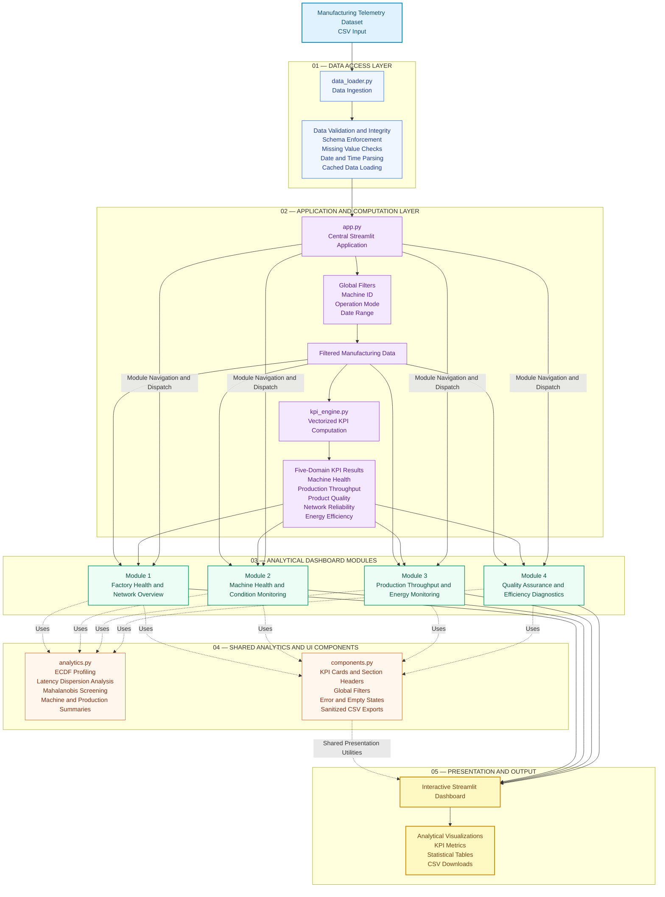

# Manufacturing Process Health and Operational Efficiency Analysis

### A Data-Driven Framework for 6G-Oriented Smart Factories

An integrated manufacturing analytics platform for monitoring machine health, production performance, energy consumption, network quality of service, and operational efficiency through an interactive data-driven dashboard.

  
  

  
  
  

---

## Project Overview

Manufacturing environments generate large volumes of operational data across machines, production processes, energy consumption, product quality, and industrial network systems. Analyzing these dimensions independently can make it difficult to develop a unified understanding of manufacturing operations.

**Manufacturing Process Health and Operational Efficiency Analysis** is a Python-based, Streamlit-powered analytics platform designed to bring these operational dimensions together through an integrated dashboard.

The system processes manufacturing telemetry and provides analytical capabilities across five key domains:

- **Machine Health:** Temperature, vibration, and multivariate condition screening.
- **Production Performance:** Production speed, operational modes, and throughput analysis.
- **Energy Efficiency:** Power consumption and Specific Energy Consumption (SEC).
- **Network Quality of Service:** Network latency, packet loss, and empirical distribution profiling.
- **Manufacturing Quality:** Defect rates, process error rates, and efficiency-status analysis.

The project establishes a data-driven analytical framework for **6G-oriented smart manufacturing**, with an emphasis on interpretable metrics, statistical analysis, and transparent evaluation of data limitations.

---

## Problem Statement

Traditional manufacturing analytics often operate across separate functional domains, creating fragmented visibility into overall production operations.

Key challenges include:

1. **Industrial Network QoS:** Network latency and packet loss are monitored separately from manufacturing performance.
2. **Machine Health Monitoring:** Temperature and vibration measurements are analyzed independently, limiting integrated equipment assessment.
3. **Production Monitoring:** Machine operating states and production throughput are tracked without sufficient cross-domain context.
4. **Energy Management:** Power consumption and energy efficiency are evaluated separately from production output.
5. **Quality Assurance:** Defect rates and process errors are assessed independently of machine, network, and energy conditions.

This fragmented approach makes it difficult to interpret relationships between operational dimensions within a unified analytical environment.

The project addresses this challenge by developing an integrated manufacturing analytics platform that brings these five domains into a common dashboard while preserving their individual metrics, units, and analytical meaning.

---

## Project Objectives

The primary objectives of this project are:

1. **Unified Manufacturing Analytics:** Integrate machine health, production, energy, network QoS, and quality metrics into a common analytical platform.
2. **Machine Condition Assessment:** Analyze temperature and vibration measurements using statistical and multivariate techniques.
3. **Production Performance Analysis:** Examine production speed, machine operating modes, and throughput patterns.
4. **Energy Efficiency Evaluation:** Calculate and analyze Specific Energy Consumption (SEC), including its mathematical expectation decomposition.
5. **Network QoS Profiling:** Evaluate network latency and packet loss using non-parametric empirical distribution analysis.
6. **Quality and Efficiency Monitoring:** Analyze defect rates, process error rates, and supplied efficiency categories.
7. **Interactive Visualization:** Provide an accessible dashboard with synchronized filters, analytical visualizations, and sanitized CSV exports.
8. **Scientific Data Validation:** Audit telemetry characteristics, identify data-quality limitations, and distinguish descriptive analysis from validated physical or predictive claims.

The broader objective is to establish an interpretable analytical foundation for future 6G-oriented smart manufacturing environments without claiming a physical 6G deployment.

---

## System Architecture

The Manufacturing Process Health and Operational Efficiency Analysis platform follows a modular, multi-layer architecture designed to integrate manufacturing telemetry processing, KPI computation, statistical analytics, and interactive dashboard visualization.

The architecture separates data ingestion, validation, application-level processing, analytical computation, and presentation into dedicated components. A centralized Streamlit application manages global filters, processes the selected telemetry records, calculates domain-specific KPIs, and dispatches the results to four specialized analytical modules.

### Architecture Diagram

### Architecture Components

| Layer | Component | Responsibility |
|---|---|---|
| Data Access | `data_loader.py` | Dataset ingestion, schema validation, integrity checks, and caching. |
| Application | `app.py` | Application initialization, global filtering, KPI orchestration, and module navigation. |
| KPI Engine | `kpi_engine.py` | Vectorized computation across five manufacturing KPI domains. |
| Analytics | `analytics.py` | Reusable statistical and analytical functions, including ECDF and Mahalanobis distance calculations. |
| Dashboard Modules | `modules/` | Four specialized interfaces for manufacturing diagnostics. |
| Shared UI | `components.py` | Reusable UI elements, filtering utilities, error handling, and CSV exports. |

### Analytical Dashboard Modules

1. **Factory Health and Network Overview:** Evaluates network latency, packet loss, empirical distributions, and within-machine latency dispersion.
2. **Machine Health and Condition Monitoring:** Examines temperature, vibration, predictive maintenance scores, and Mahalanobis distance-based geometric screening.
3. **Production Throughput and Energy Monitoring:** Analyzes production speed, operational modes, power consumption, and Specific Energy Consumption (SEC).
4. **Quality Assurance and Efficiency Diagnostics:** Evaluates defect rates, process error rates, efficiency-status distributions, and contingency relationships.

### Architecture Design Principles

- **Modularity:** Separates data processing, computation, analytics, and visualization responsibilities.
- **Reusability:** Uses common analytical functions and shared UI components across dashboard modules.
- **Vectorized Processing:** Leverages Pandas and NumPy for efficient processing of large telemetry datasets.
- **Interactive Analysis:** Provides synchronized global filters and specialized analytical views.
- **Data Integrity:** Enforces schema validation, data-quality checks, and sanitized data exports.
- **Interpretability:** Preserves individual KPI definitions and physical units instead of combining unrelated metrics into opaque composite scores.
