# Manufacturing Process Health and Operational Efficiency Analysis

### A Data-Driven Framework for 6G-Oriented Smart Factories

An integrated manufacturing analytics platform for monitoring machine health, production performance, energy consumption, network quality of service, and operational efficiency through an interactive data-driven dashboard.

  
  

  
  
  

---

## Project Overview

Manufacturing environments generate large volumes of operational data across machines, production processes, energy consumption, product quality, and industrial network systems. Analyzing these dimensions independently can make it difficult to develop a unified understanding of manufacturing operations.

**Manufacturing Process Health and Operational Efficiency Analysis** is a Python-based, Streamlit-powered analytics platform designed to bring these operational dimensions together through an integrated dashboard.

The system processes manufacturing telemetry and provides analytical capabilities across five key domains:

- **Machine Health:** Temperature, vibration, and multivariate condition screening.
- **Production Performance:** Production speed, operational modes, and throughput analysis.
- **Energy Efficiency:** Power consumption and Specific Energy Consumption (SEC).
- **Network Quality of Service:** Network latency, packet loss, and empirical distribution profiling.
- **Manufacturing Quality:** Defect rates, process error rates, and efficiency-status analysis.

The project establishes a data-driven analytical framework for **6G-oriented smart manufacturing**, with an emphasis on interpretable metrics, statistical analysis, and transparent evaluation of data limitations.

---

## Problem Statement

Traditional manufacturing analytics often operate across separate functional domains, creating fragmented visibility into overall production operations.

Key challenges include:

1. **Industrial Network QoS:** Network latency and packet loss are monitored separately from manufacturing performance.
2. **Machine Health Monitoring:** Temperature and vibration measurements are analyzed independently, limiting integrated equipment assessment.
3. **Production Monitoring:** Machine operating states and production throughput are tracked without sufficient cross-domain context.
4. **Energy Management:** Power consumption and energy efficiency are evaluated separately from production output.
5. **Quality Assurance:** Defect rates and process errors are assessed independently of machine, network, and energy conditions.

This fragmented approach makes it difficult to interpret relationships between operational dimensions within a unified analytical environment.

The project addresses this challenge by developing an integrated manufacturing analytics platform that brings these five domains into a common dashboard while preserving their individual metrics, units, and analytical meaning.

---

## Project Objectives

The primary objectives of this project are:

1. **Unified Manufacturing Analytics:** Integrate machine health, production, energy, network QoS, and quality metrics into a common analytical platform.
2. **Machine Condition Assessment:** Analyze temperature and vibration measurements using statistical and multivariate techniques.
3. **Production Performance Analysis:** Examine production speed, machine operating modes, and throughput patterns.
4. **Energy Efficiency Evaluation:** Calculate and analyze Specific Energy Consumption (SEC), including its mathematical expectation decomposition.
5. **Network QoS Profiling:** Evaluate network latency and packet loss using non-parametric empirical distribution analysis.
6. **Quality and Efficiency Monitoring:** Analyze defect rates, process error rates, and supplied efficiency categories.
7. **Interactive Visualization:** Provide an accessible dashboard with synchronized filters, analytical visualizations, and sanitized CSV exports.
8. **Scientific Data Validation:** Audit telemetry characteristics, identify data-quality limitations, and distinguish descriptive analysis from validated physical or predictive claims.

The broader objective is to establish an interpretable analytical foundation for future 6G-oriented smart manufacturing environments without claiming a physical 6G deployment.

---

## System Architecture

The application follows a modular, layered architecture. Manufacturing telemetry data is ingested and validated before entering the Streamlit application. Users can filter the dataset, generate KPI results, and navigate between four analytical dashboard modules. The selected module uses shared analytical and UI utilities to render the results.

### Architecture Diagram

### Architecture Diagram

```mermaid
flowchart LR

    A["Manufacturing Telemetry Dataset<br/>CSV Input"]
    B["data_loader.py<br/>Data Ingestion & Caching"]
    C["Data Validation & Integrity<br/>Schema Enforcement<br/>Missing-Value Checks<br/>Date-Time Parsing"]
    D["app.py<br/>Central Streamlit Application"]
    E["Global Filters<br/>Machine ID · Operation Mode<br/>Date Range"]
    F["Filtered Manufacturing Data"]
    G["kpi_engine.py<br/>Vectorized KPI Computation"]
    H["Five KPI Domains<br/>Machine Health · Production<br/>Quality · Network · Energy"]
    I["Dashboard Navigation<br/>Selected Module Dispatch"]
    J["Analytical Dashboard Modules<br/><br/>Factory Health & Network Overview<br/>Machine Health & Condition Monitoring<br/>Production Throughput & Energy Monitoring<br/>Quality Assurance & Efficiency Diagnostics"]
    K["Shared Utilities<br/>analytics.py — Statistical Analysis<br/>components.py — UI Components & CSV Export"]
    L["Interactive Streamlit Dashboard<br/>KPI Metrics · Visualizations<br/>Analytical Tables · CSV Downloads"]

    A --> B --> C --> D --> E --> F --> G --> H --> I --> J --> K --> L

    classDef source fill:#DBEAFE,stroke:#2563EB,color:#1E3A8A,stroke-width:2px;
    classDef process fill:#EFF6FF,stroke:#3B82F6,color:#1E40AF,stroke-width:1.5px;
    classDef compute fill:#E0F2FE,stroke:#0284C7,color:#075985,stroke-width:1.5px;
    classDef module fill:#DCEBFF,stroke:#2563EB,color:#1E3A8A,stroke-width:2px;
    classDef utility fill:#E0F2FE,stroke:#0284C7,color:#075985,stroke-width:1.5px;
    classDef output fill:#BFDBFE,stroke:#1D4ED8,color:#1E3A8A,stroke-width:2.5px;

    class A source;
    class B,C,D,E,F process;
    class G,H compute;
    class I,J module;
    class K utility;
    class L output;

    linkStyle default stroke:#2563EB,stroke-width:2px;
```

### Architecture Execution Sequence

1. **Data Ingestion:** `data_loader.py` loads the manufacturing telemetry CSV and performs schema validation, integrity checks, date-time parsing, and cached data loading.
2. **Application and Filtering:** `app.py` initializes the Streamlit application and provides global filters for machine ID, operation mode, and date range. The selected filters produce the filtered manufacturing dataset.
3. **KPI Computation:** `kpi_engine.py` processes the filtered dataset using vectorized computations to generate five KPI domains: machine health, production throughput, product quality, network reliability, and energy efficiency.
4. **Dashboard Dispatch:** The application passes the filtered dataset and KPI results to the dashboard module selected through navigation. Only the selected module is rendered during a given application view.
5. **Shared Utilities:** The active module uses `analytics.py` for reusable statistical computations and `components.py` for common interface elements, filtering utilities, and CSV exports.
6. **Presentation:** The Streamlit interface displays the resulting KPI metrics, visualizations, analytical summaries, tables, and downloadable data.

### Architecture Components

| Component | Responsibility |
|---|---|
| `data_loader.py` | Data ingestion, validation, parsing, and caching |
| `app.py` | Application initialization, filtering workflow, and module dispatch |
| `kpi_engine.py` | Vectorized computation across five KPI domains |
| `analytics.py` | Reusable statistical and analytical functions |
| `components.py` | Shared UI components, filters, and CSV exports |
| `modules/` | Four independent analytical dashboard modules |

The architecture separates data ingestion, application logic, KPI computation, analytical processing, and presentation. This modular design supports code reusability, maintainability, and independent development of analytical dashboard modules.
