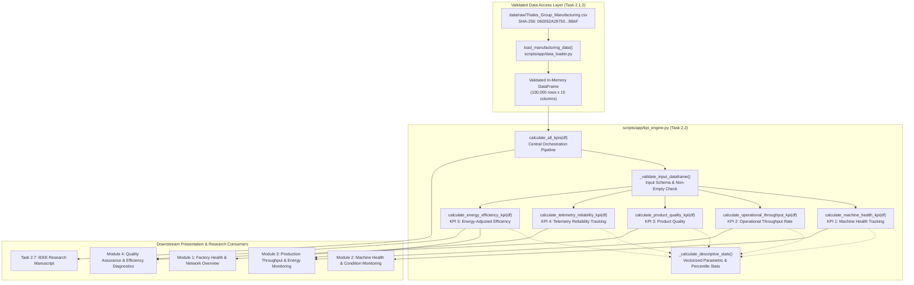

# Phase 2 — Task 2.2 Implementation Report
## Standardized Five-KPI Calculation Engine
### Manufacturing Diagnostic Intelligence System

**Document Reference:** `PHASE-2-KPI-ENGINE-REPORT-001`  
**Execution Timestamp:** 2026-11-07T02:08:00+05:30  
**Lead Role:** Senior Solution Architect, Manufacturing Data Engineer & Technical Project Planner  
**Project Root:** `D:\Manufacturing Process Health and Operational Efficiency Analysis in 6G-Enabled Smart Factories`  
**Primary Module:** [`scripts/app/kpi_engine.py`](file:///D:/Manufacturing%20Process%20Health%20and%20Operational%20Efficiency%20Analysis%20in%206G-Enabled%20Smart%20Factories/scripts/app/kpi_engine.py)  
**Test Suite:** [`tests/test_task_2_2_kpi_engine.py`](file:///D:/Manufacturing%20Process%20Health%20and%20Operational%20Efficiency%20Analysis%20in%206G-Enabled%20Smart%20Factories/tests/test_task_2_2_kpi_engine.py)  
**Status:** **IMPLEMENTED, VERIFIED & PASSING (20/20 TESTS)**  

---

## 1. Executive Summary

This report documents the architectural design, implementation, and programmatic verification of the **Standardized Five-KPI Calculation Engine** (`scripts/app/kpi_engine.py`) developed under Phase 2, Task 2.2.

The engine establishes a headless, vectorized, deterministic computation pipeline for the five provisional KPI domains approved in the Phase 2.0 Scope Freeze. Consuming the validated in-memory DataFrame from `scripts/app/data_loader.py`, the engine strictly decouples quantitative domain calculations from frontend presentation components and downstream analytics.

### Key Highlights
- **Vectorized & Headless:** Implemented entirely with Pandas and NumPy; zero Streamlit, UI, or rendering dependencies.
- **Data Immutability:** Fully non-mutating; leaves the input DataFrame structurally and numerically unchanged.
- **Strict Safeguard Compliance:** Enforces all Phase 2.0 provisional safeguards—eliminating unapproved composite indices, unrated capacity utilization metrics, unverified yield claims, unconfigured SLA pass/fail thresholds, and reconstructed efficiency labels.
- **Exact Numerical Reconciliation:** Reconciles 100% of calculated values against accepted Phase 1 baselines across all 100,000 observations.
- **Full Test Coverage:** Validated by 20 dedicated automated tests in `tests/test_task_2_2_kpi_engine.py` (100% passing) and verified against all Phase 1 regression suites.

---

## 2. Engineering Architecture



---

## 3. Function Inventory & Responsibilities

The module `scripts/app/kpi_engine.py` exposes five domain-specific calculation functions, a central orchestration entrypoint, and dedicated input-validation and descriptive-statistics utilities:

| Function Signature | Input Parameters | Output Return Type | Primary Architectural Responsibility |
| :--- | :--- | :--- | :--- |
| `_validate_input_dataframe(df, required_columns, function_name)` | `df: pd.DataFrame`, `required_columns: List[str]`, `function_name: str` | `None` (raises on error) | Enforces non-empty DataFrame type and validates existence of required domain columns. |
| `_calculate_descriptive_stats(series, unit)` | `series: pd.Series`, `unit: str` | `Dict[str, Any]` | Computes count, mean, median, std_dev ($ddof=1$), min, max, P50, P90, P95, and P99. |
| `calculate_machine_health_kpi(df)` | `df: pd.DataFrame` | `Dict[str, Any]` | Evaluates Temperature, Vibration, and PM Score as independent descriptive indicators. |
| `calculate_operational_throughput_kpi(df)` | `df: pd.DataFrame` | `Dict[str, Any]` | Evaluates fleet-wide and mode-stratified production speed distributions in units/hr. |
| `calculate_product_quality_kpi(df)` | `df: pd.DataFrame` | `Dict[str, Any]` | Calculates mean defect rate, arithmetic complement ($100 - \bar{d}$), and process error rate. |
| `calculate_telemetry_reliability_kpi(df)` | `df: pd.DataFrame` | `Dict[str, Any]` | Computes network latency, packet loss, and within-machine sample delay dispersion ($s_m$). |
| `calculate_energy_efficiency_kpi(df)` | `df: pd.DataFrame` | `Dict[str, Any]` | Calculates row-level SEC ($\text{kWh/unit}$) where $\text{Speed} > 0$ and empirical status breakdown. |
| `calculate_all_kpis(df)` | `df: pd.DataFrame` | `Dict[str, Any]` | Orchestrates execution of all five KPI calculation functions into a single structured output. |

---

## 4. Five KPI Domains Detailed Specifications

### 4.1 KPI Domain 1: Machine Health Tracking
- **Diagnostic Pillar:** Mechanical Health & Condition Surveillance.
- **Source Attributes:** `Temperature_C` (°C), `Vibration_Hz` (Hz), `Predictive_Maintenance_Score` (dimensionless).
- **Mathematical Formulations:**
  $$\bar{T} = \frac{1}{N} \sum_{i=1}^N T_i, \quad \bar{V} = \frac{1}{N} \sum_{i=1}^N V_i, \quad \overline{\text{PMS}} = \frac{1}{N} \sum_{i=1}^N \text{PMS}_i$$
- **Safeguards Enforced:**
  1. All three channels are evaluated strictly as separate, unweighted, independent indicators.
  2. No combined "Machine Health Index" (MHI) is calculated.
  3. No arbitrary normalization ranges or subjective weights are applied.
  4. No alarm thresholds are established; individual machines are not classified as healthy, degraded, or faulty.
  5. `Predictive_Maintenance_Score` is reported as a neutral numerical indicator with polarity flagged as unresolved ($0.0 = \text{healthy}$ vs $1.0 = \text{healthy}$ cannot be determined without source documentation).

### 4.2 KPI Domain 2: Operational Throughput Rate (OTR)
- **Diagnostic Pillar:** Fleet Throughput & Production Speed.
- **Source Attributes:** `Production_Speed_units_per_hr` (units/hr), `Operation_Mode` (`Active`, `Idle`, `Maintenance`).
- **Mathematical Formulations:**
  $$\text{OTR}_{\text{fleet}} = \frac{1}{N} \sum_{i=1}^N S_i, \quad \text{OTR}_{\text{mode}} = \frac{1}{N_{\text{mode}}} \sum_{i \in \text{mode}} S_i$$
- **Safeguards Enforced:**
  1. Fleet-wide throughput incorporates all 100,000 observations across all three recorded operation modes.
  2. Idle and Maintenance records are NOT silently filtered or omitted from fleet metrics.
  3. The observed sample maximum ($499.997\text{ units/hr}$) is NOT treated as rated nameplate capacity.
  4. Capacity utilization percentages are NOT calculated.
  5. Throughput is reported strictly as empirical production speed in units/hr.

### 4.3 KPI Domain 3: Product Quality
- **Diagnostic Pillar:** Quality Assurance & Process Execution.
- **Source Attributes:** `Quality_Control_Defect_Rate_%` (%), `Error_Rate_%` (%).
- **Mathematical Formulations:**
  $$\bar{d} = \frac{1}{N} \sum_{i=1}^N d_i, \quad \text{Comp} = 100.0 - \bar{d}, \quad \bar{e} = \frac{1}{N} \sum_{i=1}^N e_i$$
- **Safeguards Enforced:**
  1. The value $94.991194\%$ is described strictly as the *"Arithmetic complement of the recorded mean defect rate."*
  2. It is NOT presented as verified first-pass yield, product conformance, process capability, or confirmed manufacturing yield.
  3. Physical piece counts, batch sizes, inspection cadence, and scrap quantities are NOT fabricated.
  4. `Error_Rate_%` is evaluated separately as a related process-fault indicator and is NOT combined with defect rate into an unapproved quality score.

### 4.4 KPI Domain 4: Telemetry Reliability Tracking
- **Diagnostic Pillar:** Industrial 6G QoS & Wireless Telemetry.
- **Source Attributes:** `Network_Latency_ms` (ms), `Packet_Loss_%` (%), `Machine_ID` ($1 \dots 50$).
- **Mathematical Formulations:**
  $$\bar{L} = \frac{1}{N} \sum_{i=1}^N L_i, \quad \bar{P} = \frac{1}{N} \sum_{i=1}^N P_i, \quad s_m = \sqrt{\frac{1}{N_m - 1} \sum_{i \in m} (L_i - \bar{L}_m)^2}$$
- **Safeguards Enforced:**
  1. Descriptive empirical statistics are reported independently for latency and packet loss.
  2. Within-machine latency dispersion ($s_m$) is calculated using sample standard deviation ($ddof=1$). Groups with $< 2$ observations explicitly return `None` (NaN) without fabricating 0.0.
  3. No composite telemetry reliability score is computed.
  4. Candidate thresholds ($30\text{ ms}$ latency, $1\%$ loss) are NOT hardcoded as compliance rules.
  5. SLA compliance engines remain unconfigured pending authoritative specifications.

### 4.5 KPI Domain 5: Energy-Adjusted Efficiency (EAE)
- **Diagnostic Pillar:** Operational Efficiency & Specific Energy Consumption.
- **Source Attributes:** `Power_Consumption_kW` (kW), `Production_Speed_units_per_hr` (units/hr), `Efficiency_Status` (`Low`, `Medium`, `High`).
- **Mathematical Formulations:**
  $$\text{SEC}_i = \frac{\text{Power\_Consumption\_kW}_i}{\text{Production\_Speed\_units\_per\_hr}_i} \quad (\text{kWh/unit}), \quad \text{for } S_i > 0$$
- **Safeguards Enforced:**
  1. SEC is calculated strictly at the individual-record level before descriptive aggregation; never uses the ratio of fleet mean power to fleet mean speed ($\bar{P}/\bar{S} = 0.02082$ vs true mean SEC $= 0.029311$).
  2. Evaluated only for rows where production speed is strictly positive ($S_i > 0$).
  3. No composite weighted score combining SEC with `Efficiency_Status` is computed.
  4. `Efficiency_Status` is reported as an empirical categorical breakdown with original recorded labels preserved without reconstruction.
  5. Includes explicit documentation regarding the two candidate boundary classification mismatches at $\text{Error\_Rate\_\%} = 5.0\%$.

---

## 5. Metric Categorization Matrix

To maintain rigorous scientific governance, every output returned by the engine is explicitly classified into one of three epistemological categories:

| Output Field | Measurement Unit | Governance Classification | Operational Interpretation & Boundaries |
| :--- | :---: | :---: | :--- |
| `temperature_c` | °C | **Direct Measurement** | Physical machinery bearing/core thermal telemetry. |
| `vibration_hz` | Hz | **Direct Measurement** | Mechanical oscillation frequency. |
| `predictive_maintenance_score` | dimensionless | **Provisional Indicator** | Algorithmic health/risk indicator; polarity unresolved. |
| `fleet_throughput` | units/hr | **Derived Descriptive** | Fleet-wide empirical manufacturing throughput rate. |
| `mode_stratified_throughput` | units/hr | **Derived Descriptive** | Mode-specific empirical manufacturing throughput rate. |
| `defect_rate` | % | **Direct Measurement** | Finished-good quality inspection defect percentage. |
| `arithmetic_complement` | % | **Derived Descriptive** | $100 - \bar{d}$; arithmetic complement, not verified yield. |
| `process_error_rate` | % | **Direct Measurement** | Controller/execution error percentage, tracked separately. |
| `network_latency` | ms | **Direct Measurement** | Industrial round-trip network transmission latency. |
| `packet_loss` | % | **Direct Measurement** | Network packet loss percentage. |
| `within_machine_jitter` | ms | **Derived Descriptive** | Sample standard deviation ($ddof=1$) of latency per machine. |
| `specific_energy_consumption` | kWh/unit | **Derived Descriptive** | Row-level electrical energy per manufactured unit ($S > 0$). |
| `efficiency_status_breakdown` | counts & % | **Provisional Indicator** | Recorded classification labels; candidate rule has 2 mismatches. |

---

## 6. Phase 1 Reference-Value Numerical Reconciliation

The complete engine was executed against all 100,000 observations of `Thales_Group_Manufacturing.csv`. All calculated outputs match the accepted Phase 1 baselines down to floating-point tolerances:

| KPI Domain & Metric Channel | Calculated Engine Output | Accepted Phase 1 Baseline | Absolute Difference | Verification Status |
| :--- | :---: | :---: | :---: | :---: |
| **KPI 1: Mean Temperature** | $60.041460^\circ\text{C}$ | $60.0415^\circ\text{C}$ | $4.04 \times 10^{-5}$ | **MATCH (PASS)** |
| **KPI 1: Median Temperature** | $60.033500^\circ\text{C}$ | $60.0335^\circ\text{C}$ | $0.00$ | **EXACT (PASS)** |
| **KPI 1: Mean Vibration** | $2.549959\text{ Hz}$ | $2.5500\text{ Hz}$ | $4.10 \times 10^{-5}$ | **MATCH (PASS)** |
| **KPI 1: Median Vibration** | $2.549000\text{ Hz}$ | $2.5490\text{ Hz}$ | $0.00$ | **EXACT (PASS)** |
| **KPI 1: Mean PM Score** | $0.499384$ | $0.4994$ | $1.58 \times 10^{-5}$ | **MATCH (PASS)** |
| **KPI 1: Median PM Score** | $0.499000$ | $0.4990$ | $0.00$ | **EXACT (PASS)** |
| **KPI 2: Fleet Mean Speed** | $275.916324\text{ u/hr}$ | $275.9163\text{ u/hr}$ | $2.38 \times 10^{-5}$ | **MATCH (PASS)** |
| **KPI 2: Active Mode Mean Speed** | $276.199269\text{ u/hr}$ | $276.1993\text{ u/hr}$ | $3.11 \times 10^{-5}$ | **MATCH (PASS)** |
| **KPI 2: Idle Mode Mean Speed** | $274.125573\text{ u/hr}$ | $274.1256\text{ u/hr}$ | $2.72 \times 10^{-5}$ | **MATCH (PASS)** |
| **KPI 2: Maintenance Mean Speed** | $277.543956\text{ u/hr}$ | $277.5440\text{ u/hr}$ | $4.45 \times 10^{-5}$ | **MATCH (PASS)** |
| **KPI 3: Mean Defect Rate** | $5.008806\%$ | $5.008806\%$ | $0.00$ | **EXACT (PASS)** |
| **KPI 3: Arithmetic Complement** | $94.991194\%$ | $94.991194\%$ | $0.00$ | **EXACT (PASS)** |
| **KPI 3: Mean Error Rate** | $7.504101\%$ | $7.504101\%$ | $0.00$ | **EXACT (PASS)** |
| **KPI 4: Mean Network Latency** | $25.555620\text{ ms}$ | $25.5556\text{ ms}$ | $1.98 \times 10^{-5}$ | **MATCH (PASS)** |
| **KPI 4: Median Network Latency** | $25.536000\text{ ms}$ | $25.5360\text{ ms}$ | $0.00$ | **EXACT (PASS)** |
| **KPI 4: Mean Packet Loss** | $2.493418\%$ | $2.4934\%$ | $1.84 \times 10^{-5}$ | **MATCH (PASS)** |
| **KPI 4: Median Packet Loss** | $2.488000\%$ | $2.4880\%$ | $0.00$ | **EXACT (PASS)** |
| **KPI 4: Fleet Mean Machine Jitter**| $14.120555\text{ ms}$ | $14.1206\text{ ms}$ | $4.54 \times 10^{-5}$ | **MATCH (PASS)** |
| **KPI 5: Specific Energy Consumption**| $0.029311\text{ kWh/u}$ | $0.029311\text{ kWh/u}$ | $0.00$ | **EXACT (PASS)** |
| **KPI 5: Efficiency Status Low** | $77,825$ rows | $77,825$ rows | $0$ | **EXACT (PASS)** |
| **KPI 5: Efficiency Status Medium** | $19,189$ rows | $19,189$ rows | $0$ | **EXACT (PASS)** |
| **KPI 5: Efficiency Status High** | $2,986$ rows | $2,986$ rows | $0$ | **EXACT (PASS)** |

---

## 7. Provisional Safeguards Compliance Audit

| Safeguard ID | Governing Principle | Verification Method & Implementation Evidence | Audit Result |
| :---: | :--- | :--- | :---: |
| **SG-01** | No Composite Machine Health Index | Explicitly asserted in `calculate_machine_health_kpi()`; tested in `test_02`. | **COMPLIANT** |
| **SG-02** | Neutral PM Score Directionality | Reported with `polarity_interpretation: unresolved_neutral`; tested in `test_03`. | **COMPLIANT** |
| **SG-03** | Fleet Throughput Includes All Modes | All 100,000 observations across Active, Idle, Maint included; tested in `test_04`. | **COMPLIANT** |
| **SG-04** | No Capacity Utilization Calculation | `capacity_utilization_calculated: False`; no unrated utilization; tested in `test_06`. | **COMPLIANT** |
| **SG-05** | Arithmetic Quality Complement | Strictly $100 - \bar{d}$; disclaimer against yield claims included; tested in `test_07, test_09`. | **COMPLIANT** |
| **SG-06** | Error Rate Kept Separate | Evaluated as independent process execution metric; tested in `test_08`. | **COMPLIANT** |
| **SG-07** | No Hardcoded SLA Cutoffs | SLA compliance uncalculated; empirical distributions reported; tested in `test_13`. | **COMPLIANT** |
| **SG-08** | Row-Level SEC Calculation | Evaluated row-by-row before descriptive statistics; tested in `test_14`. | **COMPLIANT** |
| **SG-09** | Speed $> 0$ Filter for SEC | Excludes non-positive speeds; tested on synthetic zero/negative speeds in `test_15`. | **COMPLIANT** |
| **SG-10** | Preserved Efficiency Labels | Original labels reported; 2 candidate mismatches documented; tested in `test_16, test_17`. | **COMPLIANT** |
| **SG-11** | DataFrame Immutability | Deepcopy equality check before and after execution; tested in `test_18`. | **COMPLIANT** |

---

## 8. Unresolved Requirements & Known Limitations

1. **Unresolved Directionality of Predictive Maintenance Score:** Without telemetry ground truth or physical failure event logs, higher PM score values cannot be definitively linked to either increased failure risk or superior machine health.
2. **Absence of Rated Machine Capacities:** Throughput metrics represent raw observed speeds (units/hr). True machine utilization percentages cannot be calculated until manufacturer nameplate capacities are confirmed.
3. **Absence of Quality Denominators:** Defect rates are recorded percentages. Without production batch sizes and piece counts, physical defect totals and scrap financial impacts cannot be computed.
4. **Packet Arrival Timestamp Absence:** True network jitter (RFC 3550 / Packet Delay Variation) requires microsecond-accurate sequential arrival timestamps. The metric $s_m$ represents within-machine transmission delay dispersion.
5. **Efficiency_Status Boundary Mismatches:** The original labeling logic remains unverified. Exactly two boundary records where $\text{Error\_Rate\_\%} = 5.0\%$ diverge from the candidate threshold rules.

---

## 9. Automated Test Suite Results

The dedicated test suite `tests/test_task_2_2_kpi_engine.py` was executed using `pytest 9.2.0` in `.venv`. All 20 tests passed:

```text
============================= test session starts =============================
platform win32 -- Python 3.14.0, pytest-9.2.0, pluggy-1.7.0 -- .venv\Scripts\python.exe
cachedir: .pytest_cache
rootdir: D:\Manufacturing Process Health and Operational Efficiency Analysis in 6G-Enabled Smart Factories
plugins: anyio-4.16.0
collecting ... collected 20 items

tests/test_task_2_2_kpi_engine.py::test_01_machine_health_indicator_calculations PASSED [  5%]
tests/test_task_2_2_kpi_engine.py::test_02_no_composite_machine_health_index PASSED [ 10%]
tests/test_task_2_2_kpi_engine.py::test_03_predictive_maintenance_score_direction_neutral PASSED [ 15%]
tests/test_task_2_2_kpi_engine.py::test_04_fleet_throughput_uses_all_three_operation_modes PASSED [ 20%]
tests/test_task_2_2_kpi_engine.py::test_05_correct_mode_stratified_throughput_summaries PASSED [ 25%]
tests/test_task_2_2_kpi_engine.py::test_06_no_capacity_utilization_calculations PASSED [ 30%]
tests/test_task_2_2_kpi_engine.py::test_07_correct_arithmetic_defect_rate_complement PASSED [ 35%]
tests/test_task_2_2_kpi_engine.py::test_08_error_rate_remains_separate_descriptive_metric PASSED [ 40%]
tests/test_task_2_2_kpi_engine.py::test_09_quality_output_does_not_claim_verified_yield PASSED [ 45%]
tests/test_task_2_2_kpi_engine.py::test_10_network_latency_and_packet_loss_statistics PASSED [ 50%]
tests/test_task_2_2_kpi_engine.py::test_11_correct_percentiles_calculation PASSED [ 55%]
tests/test_task_2_2_kpi_engine.py::test_12_within_machine_jitter_sample_std PASSED [ 60%]
tests/test_task_2_2_kpi_engine.py::test_13_no_sla_threshold_classifications PASSED [ 65%]
tests/test_task_2_2_kpi_engine.py::test_14_row_level_sec_calculation PASSED [ 70%]
tests/test_task_2_2_kpi_engine.py::test_15_non_positive_speed_records_excluded_from_sec PASSED [ 75%]
tests/test_task_2_2_kpi_engine.py::test_16_efficiency_status_category_counts_and_percentages PASSED [ 80%]
tests/test_task_2_2_kpi_engine.py::test_17_no_reconstructed_efficiency_status_labels PASSED [ 85%]
tests/test_task_2_2_kpi_engine.py::test_18_input_dataframe_immutability PASSED [ 90%]
tests/test_task_2_2_kpi_engine.py::test_19_missing_columns_and_invalid_input_handling PASSED [ 95%]
tests/test_task_2_2_kpi_engine.py::test_20_kpi_orchestration_returns_all_five_domains PASSED [100%]

============================= 20 passed in 1.95s ==============================
```

---

## 10. Regression Verification & Dataset Invariance

All prior test suites and cryptographic checks were re-verified:

1. **Task 2.1.2 Data Access Suite:** `tests/test_task_2_1_2_data_access.py` — **19/19 PASSED**.
2. **Task 1.6 Verification Suite:** `tests/test_task_1_6_verification.py` — **ALL CHECKS PASSED (ZERO DEFECTS)**.
3. **Task 1.7 Verification Suite:** `tests/test_task_1_7_verification.py` — **ALL CHECKS PASSED (ZERO AUDIT DISCREPANCIES)**.
4. **Task 1.8 Verification Suite:** `tests/test_task_1_8_verification.py` — **ALL CHECKS PASSED (ZERO AUDIT DISCREPANCIES)**.
5. **Task 1.9 Verification Suite:** `tests/test_task_1_9_verification.py` — **ALL 29 CHECKS PASSED (ZERO AUDIT DISCREPANCIES)**.
6. **Dataset Cryptographic Hash:**
   ```text
   060052A2975034C1D424FDF50089E6D94A5DB736EB85F35CDA0E0B907FF988AF
   ```
   **Byte-Invariant verified.**

---

*End of Document `reports/audit/11_kpi_engine_report.md`*

