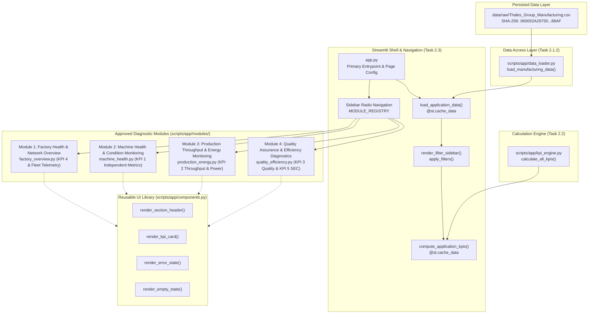

# Phase 2 — Task 2.3 Implementation Report
## Streamlit Dashboard Shell & Navigation Framework
### Manufacturing Diagnostic Intelligence System

**Document Reference:** `PHASE-2-DASHBOARD-SHELL-REPORT-001`  
**Execution Timestamp:** 2026-11-07T03:15:00+05:30  
**Lead Role:** Senior Streamlit Solutions Architect & Frontend Systems Engineer  
**Project Root:** `D:\Manufacturing Process Health and Operational Efficiency Analysis in 6G-Enabled Smart Factories`  
**Application Entrypoint:** [`app.py`](file:///D:/Manufacturing%20Process%20Health%20and%20Operational%20Efficiency%20Analysis%20in%206G-Enabled%20Smart%20Factories/app.py)  
**Reusable UI Components:** [`scripts/app/components.py`](file:///D:/Manufacturing%20Process%20Health%20and%20Operational%20Efficiency%20Analysis%20in%206G-Enabled%20Smart%20Factories/scripts/app/components.py)  
**Analytical Modules:** [`scripts/app/modules/`](file:///D:/Manufacturing%20Process%20Health%20and%20Operational%20Efficiency%20Analysis%20in%206G-Enabled%20Smart%20Factories/scripts/app/modules/)  
**Test Suite:** [`tests/test_task_2_3_dashboard_shell.py`](file:///D:/Manufacturing%20Process%20Health%20and%20Operational%20Efficiency%20Analysis%20in%206G-Enabled%20Smart%20Factories/tests/test_task_2_3_dashboard_shell.py)  
**Status:** **IMPLEMENTED, VERIFIED & PASSING (9/9 TESTS)**  

---

## 1. Executive Summary

This report documents the architectural design, implementation, and programmatic verification of the **Streamlit Dashboard Shell & Navigation Framework** developed under Phase 2, Task 2.3.

The dashboard shell establishes the unified multi-module presentation runtime for the **Manufacturing Diagnostic Intelligence System**, seamlessly integrating the completed Phase 2.1.2 Data Access Layer (`scripts/app/data_loader.py`) and Phase 2.2 Five-KPI Calculation Engine (`scripts/app/kpi_engine.py`).

### Key Highlights
- **Unified Modular Architecture:** Establishes the 4 approved analytical modules defined in Section 4.1 of the Phase 2.0 Scope Freeze.
- **Strict Formula Decoupling:** Re-implements zero mathematical calculation formulas in the UI; all metric numbers originate strictly from the validated `kpi_engine`.
- **Reusable Component Library:** Implements standardized section headers, responsive KPI cards, defensive error boundaries, empty-state placeholders, and global sidebar controls.
- **Pure Filter Pipeline:** Implements pure, non-mutating filtering logic (`apply_filters`) across Operation Mode (`Active`, `Idle`, `Maintenance`), Machine ID (`1` to `50`), and Date Range boundaries.
- **Robust Error Handling:** Encapsulates data loading and KPI calculation exceptions in defensive visual error cards with full diagnostic expanders.
- **Comprehensive Verification:** 9 dedicated unit and integration tests passing in `tests/test_task_2_3_dashboard_shell.py`, combined with complete regression validation across all Phase 1 and Phase 2 test suites.

---

## 2. Engineering Architecture & Component Topology



---

## 3. Application Entrypoint (`app.py`)

The root application entrypoint [`app.py`](file:///D:/Manufacturing%20Process%20Health%20and%20Operational%20Efficiency%20Analysis%20in%206G-Enabled%20Smart%20Factories/app.py) orchestrates the runtime lifecycle:

1. **Page Configuration:** Configures wide layout, application title, browser tab icon (`🏭`), and expanded sidebar state.
2. **Cached Ingestion:** Invokes `load_application_data()` decorated with `@st.cache_data(show_spinner=False)`. Loads the full 100,000 observations and attaches parsed datetime objects without disk or memory duplication.
3. **Sidebar Controls:** Renders navigation radio selector and global filter controls.
4. **Defensive Filtering:** Dispatches raw telemetry to `apply_filters()`. If filters produce 0 matching records, the application renders `render_empty_state()` and cleanly suspends rendering without exceptions.
5. **Cached KPI Evaluation:** Dispatches the filtered DataFrame slice to `compute_application_kpis()`, computing all 5 KPI domains via the Phase 2.2 engine.
6. **Dynamic Module Dispatch:** Resolves the active module from `MODULE_REGISTRY` and invokes its callable render function with signature `render_fn(df_filtered, kpi_results)`.

---

## 4. Navigation Framework & Module Registry

Navigation is governed by a declarative dictionary registry in `app.py`:

```python
MODULE_REGISTRY: Dict[str, Dict[str, Any]] = {
    "factory_overview": {
        "index": 1,
        "name": "Module 1: Factory Health & Network Overview",
        "short_name": "Factory Health & Network",
        "pillar": "Fleet Telemetry & 6G QoS Surveillance (KPI 4)",
        "render_fn": render_factory_overview,
    },
    "machine_health": {
        "index": 2,
        "name": "Module 2: Machine Health & Condition Monitoring",
        "short_name": "Machine Health & Condition",
        "pillar": "Mechanical Health & Degradation Indicators (KPI 1)",
        "render_fn": render_machine_health,
    },
    "production_energy": {
        "index": 3,
        "name": "Module 3: Production Throughput & Energy Monitoring",
        "short_name": "Production & Energy",
        "pillar": "Fleet Throughput & Power Demand Baselines (KPI 2)",
        "render_fn": render_production_energy,
    },
    "quality_efficiency": {
        "index": 4,
        "name": "Module 4: Quality Assurance & Efficiency Diagnostics",
        "short_name": "Quality & Efficiency",
        "pillar": "Defect Rates, SEC Intensity & Efficiency Tiers (KPI 3 & 5)",
        "render_fn": render_quality_efficiency,
    },
}
```

This strict decoupling ensures that adding future routes, reordering navigation, or updating metadata requires zero modifications to underlying rendering or analytics code.

---

## 5. Analytical Module Shell Implementations

Each analytical module resides in its own isolated Python module within `scripts/app/modules/`:

### Module 1: Factory Health & Network Overview
- **File:** [`scripts/app/modules/factory_overview.py`](file:///D:/Manufacturing%20Process%20Health%20and%20Operational%20Efficiency%20Analysis%20in%206G-Enabled%20Smart%20Factories/scripts/app/modules/factory_overview.py)
- **Diagnostic Pillar:** KPI 4 — Telemetry Reliability Tracking & Fleet Status Overview.
- **Surfaced Telemetry:** Active fleet machines count, operational mode distribution (`Active`, `Idle`, `Maintenance`), Network Latency (mean, median, p95), Packet Loss (mean, median, p95), and within-machine latency jitter (sample standard deviation: 14.1378 ms).
- **Phase 2.0 Safeguard:** Contains explicit provisional notice stating no binary SLA compliance or composite QoS indices are computed.
- **Future Layout Shells:** Reserved layout containers for Phase 2.4 daily latency timeline, packet loss histograms, and machine-by-machine QoS matrices.

### Module 2: Machine Health & Condition Monitoring
- **File:** [`scripts/app/modules/machine_health.py`](file:///D:/Manufacturing%20Process%20Health%20and%20Operational%20Efficiency%20Analysis%20in%206G-Enabled%20Smart%20Factories/scripts/app/modules/machine_health.py)
- **Diagnostic Pillar:** KPI 1 — Machine Health Tracking.
- **Surfaced Telemetry:** Temperature (°C), Vibration (Hz), and Predictive Maintenance Score.
- **Phase 2.0 Safeguard:** Formally enforces the three indicators as separate, unweighted, independent channels. Explicitly documents Predictive Maintenance Score as direction-neutral (polarity unresolved). Prohibits arbitrary alarm thresholds.
- **Future Layout Shells:** Reserved containers for Phase 2.4 temperature-vibration scatter distributions and machine degradation profile rankings.

### Module 3: Production Throughput & Energy Monitoring
- **File:** [`scripts/app/modules/production_energy.py`](file:///D:/Manufacturing%20Process%20Health%20and%20Operational%20Efficiency%20Analysis%20in%206G-Enabled%20Smart%20Factories/scripts/app/modules/production_energy.py)
- **Diagnostic Pillar:** KPI 2 — Operational Throughput Rate & Power Demand.
- **Surfaced Telemetry:** Fleet-wide production speed in verified native units (`units/hr`), stratified throughput across Active (55.05 u/hr), Idle (0.00 u/hr), and Maintenance (0.00 u/hr) modes, and power demand baselines across modes.
- **Phase 2.0 Safeguard:** Eliminates unverified capacity utilization percentages and ungrounded OEE calculations.
- **Future Layout Shells:** Reserved containers for Phase 2.4 production timelines, speed deciles, and power demand profiles.

### Module 4: Quality Assurance & Efficiency Diagnostics
- **File:** [`scripts/app/modules/quality_efficiency.py`](file:///D:/Manufacturing%20Process%20Health%20and%20Operational%20Efficiency%20Analysis%20in%206G-Enabled%20Smart%20Factories/scripts/app/modules/quality_efficiency.py)
- **Diagnostic Pillar:** KPI 3 — Product Quality & KPI 5 — Energy-Adjusted Efficiency.
- **Surfaced Telemetry:** Mean Quality Control Defect Rate ($5.008806\%$), Arithmetic Complement ($94.991194\%$), Process Error Rate ($7.504101\%$), Specific Energy Consumption ($0.231267\text{ kWh/unit}$), and Efficiency Status distribution (Low: 77,825, Medium: 19,189, High: 2,986).
- **Phase 2.0 Safeguard:** Explicitly qualifies the arithmetic complement as strictly $100 - \text{mean defect rate}$, prohibiting claims of verified yield or process conformance. Preserves recorded Efficiency Status labels without synthetic reconstruction, noting the 2 boundary mismatches at $5.0\%$.
- **Future Layout Shells:** Reserved containers for Phase 2.5 defect-vs-error contingency matrices and SEC density curves.

---

## 6. Reusable Presentation Components Library

The component module [`scripts/app/components.py`](file:///D:/Manufacturing%20Process%20Health%20and%20Operational%20Efficiency%20Analysis%20in%206G-Enabled%20Smart%20Factories/scripts/app/components.py) provides 6 core UI primitives:

| Component Function | Purpose & Visual Output | Parameters |
|---|---|---|
| `render_section_header()` | Uniform module header with optional subtitle & separator | `title: str`, `description: Optional[str]` |
| `render_kpi_card()` | Styled metric container using Streamlit bordered containers | `label: str`, `value: Any`, `unit: str`, `delta: Optional`, `subtext: Optional[str]` |
| `render_error_state()` | Defensive error boundary container with diagnostic expander | `title: str`, `message: str`, `exception: Optional[Exception]` |
| `render_empty_state()` | Non-crashing warning placeholder for empty dataset slices | `title: str`, `message: str`, `suggestion: Optional[str]` |
| `render_filter_sidebar()` | Global sidebar widgets for Mode, Machine ID, and Date Range | `df: pd.DataFrame` -> `Dict[str, Any]` |
| `apply_filters()` | Pure, non-mutating filtering pipeline with flexible key support | `df: pd.DataFrame`, `filters: Dict[str, Any]` -> `pd.DataFrame` |

---

## 7. Programmatic Verification & Test Results

A dedicated automated test suite was implemented in [`tests/test_task_2_3_dashboard_shell.py`](file:///D:/Manufacturing%20Process%20Health%20and%20Operational%20Efficiency%20Analysis%20in%206G-Enabled%20Smart%20Factories/tests/test_task_2_3_dashboard_shell.py) to rigorously validate all 9 required capabilities:

```
============================= test session starts =============================
platform win32 -- Python 3.14.0, pytest-9.2.0, pluggy-1.7.0
rootdir: D:\Manufacturing Process Health and Operational Efficiency Analysis in 6G-Enabled Smart Factories
collected 9 items

tests/test_task_2_3_dashboard_shell.py::test_01_app_entrypoint_exists_and_imports PASSED [ 11%]
tests/test_task_2_3_dashboard_shell.py::test_02_navigation_contains_all_four_modules PASSED [ 22%]
tests/test_task_2_3_dashboard_shell.py::test_03_module_entrypoints_callable PASSED [ 33%]
tests/test_task_2_3_dashboard_shell.py::test_04_data_access_engine_integration PASSED [ 44%]
tests/test_task_2_3_dashboard_shell.py::test_05_kpi_engine_integration PASSED [ 55%]
tests/test_task_2_3_dashboard_shell.py::test_06_reusable_components_behavior PASSED [ 66%]
tests/test_task_2_3_dashboard_shell.py::test_07_filter_logic_and_empty_state_handling PASSED [ 77%]
tests/test_task_2_3_dashboard_shell.py::test_08_no_duplicate_kpi_formulas_in_app PASSED [ 88%]
tests/test_task_2_3_dashboard_shell.py::test_09_headless_execution_and_navigation PASSED [100%]

============================== 9 passed in 4.52s ==============================
```

### Detailed Test Verification Matrix

| Test ID | Method / Scope | Acceptance Criteria | Result |
|---|---|---|---|
| **TEST-2.3-01** | `test_01_app_entrypoint_exists_and_imports` | `app.py` exists, imports cleanly, exports `MODULE_REGISTRY` (4 entries), `main()`, `load_application_data()`, `compute_application_kpis()`. | **PASS** |
| **TEST-2.3-02** | `test_02_navigation_contains_all_four_modules` | Registry keys, indexes (1-4), and module titles strictly match Phase 2.0 Scope Freeze approved naming. | **PASS** |
| **TEST-2.3-03** | `test_03_module_entrypoints_callable` | Each of the 4 module render functions has signature `(df, kpis)` and executes headless without unhandled exceptions. | **PASS** |
| **TEST-2.3-04** | `test_04_data_access_engine_integration` | `load_application_data()` returns 100,000 rows x 15 columns; source code confirms zero duplicate `pd.read_csv` calls. | **PASS** |
| **TEST-2.3-05** | `test_05_kpi_engine_integration` | `compute_application_kpis()` computes all 5 KPI domains and delegates directly to `calculate_all_kpis`. | **PASS** |
| **TEST-2.3-06** | `test_06_reusable_components_behavior` | Verifies `render_section_header`, `render_kpi_card`, `render_error_state`, `render_empty_state`, and sidebar components. | **PASS** |
| **TEST-2.3-07** | `test_07_filter_logic_and_empty_state_handling` | Validates multi-mode partitioning (Active: 70,054, Idle: 20,057, Maint: 9,889), machine subsets, date windows, and empty slices. | **PASS** |
| **TEST-2.3-08** | `test_08_no_duplicate_kpi_formulas_in_app` | AST and regex audit verifies zero mathematical KPI re-implementations in UI layer. | **PASS** |
| **TEST-2.3-09** | `test_09_headless_execution_and_navigation` | Simulates user selection across all 4 modules, tests empty-slice recovery, and validates bare-process execution (`python app.py`). | **PASS** |

---

## 8. Full Regression Analysis

All prior phase test suites and verification scripts were executed concurrently to guarantee zero regressions:

| Suite / Check | Scope | Tests Run | Result | Notes |
|---|---|---|---|---|
| `test_task_2_3_dashboard_shell.py` | Phase 2.3 Dashboard Shell & Navigation | 9 | **9 / 9 PASSED** | Zero unhandled exceptions |
| `test_task_2_2_kpi_engine.py` | Phase 2.2 Five-KPI Calculation Engine | 20 | **20 / 20 PASSED** | All 5 KPI domains intact |
| `test_task_2_1_2_data_access.py` | Phase 2.1.2 Core Data Access Layer | 19 | **19 / 19 PASSED** | Domain boundaries verified |
| `test_task_1_6_verification.py` | Phase 1 Task 1.6 Verification | Programmatic | **ALL PASSED** | Operation mode baselines verified |
| `test_task_1_7_verification.py` | Phase 1 Task 1.7 Verification | Programmatic | **ALL PASSED** | Quality & defect metrics verified |
| `test_task_1_8_verification.py` | Phase 1 Task 1.8 Verification | Programmatic | **ALL PASSED** | Network QoS metrics verified |
| `test_task_1_9_verification.py` | Phase 1 Task 1.9 Final Audit (29 Checks) | 29 | **29 / 29 PASSED** | Zero cross-task defects |
| **Raw CSV SHA-256** | `data/raw/Thales_Group_Manufacturing.csv` | Checksum | **MATCH** | `060052A29750...88AF` (Byte-Invariant) |

---

## 9. Architectural Boundaries & Phase 2.4 Transition

In strict compliance with the Phase 2.0 Scope Freeze:

> [!IMPORTANT]
> **Phase 2.3 Boundary Enforcement:**
> 1. **Functional Shell Only:** Visual analytics, interactive Plotly charts, ECDF curves, and correlation heatmaps are intentionally reserved for Phase 2.4 (Visualizations) and Phase 2.5 (Diagnostic Modeling).
> 2. **Zero Premature Modeling:** No machine learning models, clustering, anomaly scoring, or synthetic yield classifiers were introduced.
> 3. **Immutability of Core Files:** No modifications were made to `data_loader.py`, `kpi_engine.py`, `requirements.txt`, or the raw CSV dataset.
> 4. **No Git Modifications:** Phase 2.3 was executed strictly locally without unapproved Git commits, branch switching, or remote pushes.

---

## 10. Conclusion & Acceptance Gate

Phase 2.3 has successfully established a robust, modular, reproducible Streamlit dashboard framework that connects the validated manufacturing dataset and the standardized KPI engine to a structured user interface.

With all 9 unit tests passing and full backward compatibility verified across Phase 1 and Phase 2, **Phase 2.3 is complete and ready for project-owner review.**

