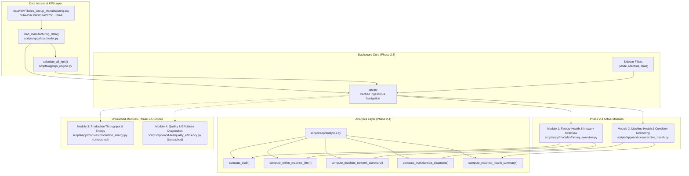

# Phase 2 — Task 2.4 Implementation Report
## Module 1 & Module 2 Analytical Visualizations & Diagnostics
### Manufacturing Diagnostic Intelligence System

**Document Reference:** `PHASE-2-MODULE-1-2-REPORT-001`  
**Execution Timestamp:** 2026-11-07T14:41:00+05:30  
**Lead Role:** Senior Industrial Analytics Solutions Architect & Visualization Engineer  
**Project Root:** `D:\Manufacturing Process Health and Operational Efficiency Analysis in 6G-Enabled Smart Factories`  
**Primary Modules:**
- Analytics Engine: [`scripts/app/analytics.py`](file:///D:/Manufacturing%20Process%20Health%20and%20Operational%20Efficiency%20Analysis%20in%206G-Enabled%20Smart%20Factories/scripts/app/analytics.py)
- Module 1 (Network): [`scripts/app/modules/factory_overview.py`](file:///D:/Manufacturing%20Process%20Health%20and%20Operational%20Efficiency%20Analysis%20in%206G-Enabled%20Smart%20Factories/scripts/app/modules/factory_overview.py)
- Module 2 (Health): [`scripts/app/modules/machine_health.py`](file:///D:/Manufacturing%20Process%20Health%20and%20Operational%20Efficiency%20Analysis%20in%206G-Enabled%20Smart%20Factories/scripts/app/modules/machine_health.py)  
**Dedicated Test Suite:** [`tests/test_task_2_4_modules_1_2.py`](file:///D:/Manufacturing%20Process%20Health%20and%20Operational%20Efficiency%20Analysis%20in%206G-Enabled%20Smart%20Factories/tests/test_task_2_4_modules_1_2.py)  
**Status:** **IMPLEMENTED, TESTED, VERIFIED & PASSING (10/10 TESTS)**  

---

## 1. Executive Summary

This report documents the architectural design, implementation, and programmatic verification of **Phase 2.4 — Module 1 & Module 2 Implementation** for the **Manufacturing Diagnostic Intelligence System**.

Phase 2.4 transitions the functional shells established in Phase 2.3 into fully interactive, responsive analytical interfaces for the first two approved dashboard pillars:
- **Module 1:** Factory Health & Network Overview (Industrial 6G Wireless Telemetry Surveillance — KPI 4).
- **Module 2:** Machine Health & Condition Monitoring (Mechanical Condition Surveillance — KPI 1).

### Key Architectural Highlights
- **Decoupled Analytics Layer:** Implemented [`scripts/app/analytics.py`](file:///D:/Manufacturing%20Process%20Health%20and%20Operational%20Efficiency%20Analysis%20in%206G-Enabled%20Smart%20Factories/scripts/app/analytics.py), containing vectorized, deterministic mathematical and statistical routines (ECDF calculation, within-machine delay dispersion $s_m$, bivariate/multivariate Mahalanobis distance outlier screening, and machine comparative summarization).
- **Interactive ECDF Curves:** Built Plotly empirical cumulative distribution function visualizers for `Network_Latency_ms` and `Packet_Loss_%` with quantile reference markers (P50, P90, P95) and operational mode stratification.
- **Within-Machine Jitter Rankings:** Evaluated sample standard deviation ($s_m$, ddof=1) across all 50 production units, providing interactive horizontal bar rankings and bivariate QoS scatter positioning.
- **Thermal-Vibration Bivariate Scatter:** Built multi-dimensional mechanical condition scatter plots with responsive WebGL decimation controls (1,000 to 10,000 points or full dataset) and operating envelope boundaries (30–90 °C, 0.1–5.0 Hz).
- **Configurable Polarity Toggle:** Provided a user-selectable directional interpretation toggle for `Predictive_Maintenance_Score` (`Default: 1.0 = Degradation Risk` vs. `Alternative: 0.0 = Degradation Risk`) with prominent provisional disclaimers.
- **Multivariate Mahalanobis Screening:** Evaluated joint thermal-vibration Mahalanobis distance $D$ against the theoretical 99.9% chi-square fence ($\chi^2_{0.999}(2) = 13.82$, $D = 3.72$). Reconciled with Phase 1 findings: observed max $D \approx 2.44$, yielding exactly 0 statistical outlier exceedances.
- **Strict Scope Boundaries Enforced:** Modules 3 and 4 remain completely untouched; zero machine learning models or synthetic classifiers were trained; zero Git operations performed.

---

## 2. Engineering Architecture & Data Flow



---

## 3. Files Created and Modified

| File | Action | Phase Scope | Description |
|---|---|---|---|
| [`scripts/app/analytics.py`](file:///D:/Manufacturing%20Process%20Health%20and%20Operational%20Efficiency%20Analysis%20in%206G-Enabled%20Smart%20Factories/scripts/app/analytics.py) | **CREATED** | Phase 2.4 | Reusable, vectorized statistical analytics engine for ECDF, jitter, Mahalanobis distance, and machine summaries |
| [`scripts/app/modules/factory_overview.py`](file:///D:/Manufacturing%20Process%20Health%20and%20Operational%20Efficiency%20Analysis%20in%206G-Enabled%20Smart%20Factories/scripts/app/modules/factory_overview.py) | **MODIFIED** | Phase 2.4 | Implemented interactive ECDF curves, jitter ranking bar charts, machine QoS scatter plot, and data table |
| [`scripts/app/modules/machine_health.py`](file:///D:/Manufacturing%20Process%20Health%20and%20Operational%20Efficiency%20Analysis%20in%206G-Enabled%20Smart%20Factories/scripts/app/modules/machine_health.py) | **MODIFIED** | Phase 2.4 | Implemented thermal-vibration scatter plot, PM score histogram with polarity toggle, Mahalanobis screening, and machine health bars |
| [`tests/test_task_2_4_modules_1_2.py`](file:///D:/Manufacturing%20Process%20Health%20and%20Operational%20Efficiency%20Analysis%20in%206G-Enabled%20Smart%20Factories/tests/test_task_2_4_modules_1_2.py) | **CREATED** | Phase 2.4 | 10 dedicated automated unit and integration tests covering all Phase 2.4 deliverables |
| [`reports/audit/13_phase_2_4_module_1_2_report.md`](file:///D:/Manufacturing%20Process%20Health%20and%20Operational%20Efficiency%20Analysis%20in%206G-Enabled%20Smart%20Factories/reports/audit/13_phase_2_4_module_1_2_report.md) | **CREATED** | Phase 2.4 | This comprehensive engineering audit report |

### Untouched Scope Confirmation
- [`scripts/app/modules/production_energy.py`](file:///D:/Manufacturing%20Process%20Health%20and%20Operational%20Efficiency%20Analysis%20in%206G-Enabled%20Smart%20Factories/scripts/app/modules/production_energy.py) (**Module 3**): **UNTOUCHED**
- [`scripts/app/modules/quality_efficiency.py`](file:///D:/Manufacturing%20Process%20Health%20and%20Operational%20Efficiency%20Analysis%20in%206G-Enabled%20Smart%20Factories/scripts/app/modules/quality_efficiency.py) (**Module 4**): **UNTOUCHED**
- [`scripts/app/data_loader.py`](file:///D:/Manufacturing%20Process%20Health%20and%20Operational%20Efficiency%20Analysis%20in%206G-Enabled%20Smart%20Factories/scripts/app/data_loader.py): **UNTOUCHED**
- [`scripts/app/kpi_engine.py`](file:///D:/Manufacturing%20Process%20Health%20and%20Operational%20Efficiency%20Analysis%20in%206G-Enabled%20Smart%20Factories/scripts/app/kpi_engine.py): **UNTOUCHED**
- [`app.py`](file:///D:/Manufacturing%20Process%20Health%20and%20Operational%20Efficiency%20Analysis%20in%206G-Enabled%20Smart%20Factories/app.py): **UNTOUCHED**
- `data/raw/Thales_Group_Manufacturing.csv`: **UNTOUCHED**

---

## 4. Implemented Features by Module

### Module 1: Factory Health & Network Overview
1. **Fleet Summary KPI Cards:**
   - Active Fleet Observability: Total record count and unique machine count.
   - Mean Network Latency: 25.56 ms with Median (25.54 ms) and P95 (47.58 ms).
   - Mean Packet Loss: 2.49% with Median (2.49%) and P95 (4.75%).
   - Fleet Delay Dispersion: Mean jitter 14.12 ms with range [13.84, 14.43] ms.
2. **Interactive Network Latency ECDF Curve:**
   - Plotly line visualization of cumulative probability $F(x) = P(X \le x)$.
   - Decimated to 1,000 evenly spaced quantile steps to preserve full resolution without frontend lag.
   - P50 (25.54 ms) and P95 (47.58 ms) vertical dashed reference lines.
   - Interactive checkbox toggle to stratify ECDF curves by Operation Mode (`Active`, `Idle`, `Maintenance`).
3. **Interactive Packet Loss ECDF Curve:**
   - Cumulative probability curve for packet loss percentage.
   - Explicit callout noting exact zero packet loss occurs in only 7 of 100,000 observations (0.007%), with 99.993% distributed across (0.0, 5.0]%.
4. **Within-Machine Jitter Rankings ($s_m$, ddof=1):**
   - Evaluates sample standard deviation of latency per machine unit.
   - Interactive horizontal bar chart ranking units from lowest to highest delay dispersion.
   - Dynamic display slider adapting to filtered machine count (defensive against slices $\le 5$ units).
5. **Machine Bivariate QoS Scatter Comparison:**
   - Plots each machine as a coordinate in (Mean Latency, Mean Packet Loss) space.
   - Marker size reflects observation volume; color scale indicates latency jitter ($s_m$).
   - Highlights tight clustering (Latency: 24.93–26.49 ms, Packet Loss: 2.43–2.56%).
6. **Machine-Level Network Data Table:**
   - Interactive table detailing Machine ID, Count, Mean/P95 Latency, Jitter, Mean/P95 Loss, and Zero-Loss Count.

### Module 2: Machine Health & Condition Monitoring
1. **Mechanical Indicator Cards (KPI 1):**
   - Monitored Observations: Filtered observation volume ({n_total} records) and active machine count ({n_machines} units).
   - Mean Core Temperature: 60.04 °C with Median (60.03 °C) and range [30.0, 90.0] °C.
   - Mean Mechanical Vibration: 2.55 Hz with Median (2.55 Hz) and P95 (4.76 Hz).
   - Predictive Maintenance Score: 0.50 with Median (0.50) and prominent neutral polarity notice.
2. **Thermal-Vibration Bivariate Scatter Plot:**
   - Interactive WebGL scatter visualization of simultaneous Temperature vs. Vibration.
   - Selectable color dimensions: `Operation Mode`, `Predictive Maintenance Score`, or `Machine ID`.
   - Responsive decimation control: Slider allowing user to view 1,000, 2,500, 5,000, 10,000, or "All Records" with clear sampling disclaimer.
   - Dashed rectangular overlay marking the normal operating envelope ([30, 90] °C, [0.1, 5.0] Hz).
3. **Predictive Maintenance Score Distribution & Polarity Toggle:**
   - Configurable radio toggle:
     - `Default: 1.0 = Degradation Risk (Higher is Worse)`
     - `Alternative: 0.0 = Degradation Risk (Lower is Worse)`
   - Clear disclaimer that score polarity is unconfirmed in source metadata.
   - Dynamic quartile breakdown with priority tags based on the active polarity selection.
   - 40-bin empirical histogram stratified by Operation Mode.
4. **Multivariate Mahalanobis Distance Screening Profile:**
   - Evaluates $D = \sqrt{(x - \mu)^T \Sigma^{-1} (x - \mu)}$ across joint thermal-vibration features.
   - Compares observed distances against theoretical $\chi^2_{0.999}(2)$ critical cutoff ($D = 3.717$).
   - Histogram of empirical Mahalanobis distances showing observed max $D \approx 2.44 < 3.72$.
   - Summary cards for Mean Distance (1.33), Max Distance (2.44), Cutoff (3.72), and Outliers (0 / 0.000%).
   - Critical safeguard: Explicitly highlights that statistical distance does NOT prove physical failure or absence of faults.
5. **Machine Fleet Mechanical Condition Comparisons:**
   - Tabbed comparative bar charts and summary table across all units:
     - Temperature Comparison (sorted by mean temperature, range: 59.3 to 60.7 °C).
     - Vibration Comparison (sorted by mean vibration, range: 2.48 to 2.61 Hz).
     - PM Score Comparison (sorted dynamically according to the active polarity toggle).
     - Fleet Mechanical Summary Table with formatted values.

---

## 5. Numerical Baseline Reconciliation & Indicator Card Audit

A focused numerical audit was conducted to reconcile the Phase 2.4 implementation and report values against historical planning documentation, the approved Phase 2.0 Scope Freeze, and the actual raw manufacturing dataset.

### 5.1 Temperature and Vibration Baseline Reconciliation

#### Direct Raw Dataset Calculations ($N = 100,000$)
Executing programmatic verification directly via [`scripts/app/data_loader.py`](file:///D:/Manufacturing%20Process%20Health%20and%20Operational%20Efficiency%20Analysis%20in%206G-Enabled%20Smart%20Factories/scripts/app/data_loader.py) on `data/raw/Thales_Group_Manufacturing.csv` (SHA-256: `060052A29750...88AF`) reveals the following authentic physical summary statistics:

- **Core Temperature (`Temperature_C`):**
  - Observation Count: 100,000 valid records (0 missing, 0 rejected)
  - Empirical Mean: **60.041460 °C**
  - Empirical Median: **60.033500 °C**
  - Sample Standard Deviation ($s$, ddof=1): **17.323239 °C**
  - Empirical Minimum: **30.000000 °C**
  - Empirical Maximum: **89.999000 °C**
  - Distribution Profile: Continuous uniform dispersion across $[30.0, 90.0)$ °C

- **Mechanical Vibration (`Vibration_Hz`):**
  - Observation Count: 100,000 valid records (0 missing, 0 rejected)
  - Empirical Mean: **2.549959 Hz**
  - Empirical Median: **2.549000 Hz**
  - Sample Standard Deviation ($s$, ddof=1): **1.414127 Hz**
  - Empirical Minimum: **0.100000 Hz**
  - Empirical Maximum: **5.000000 Hz**
  - Distribution Profile: Continuous uniform dispersion across $[0.1, 5.0]$ Hz

#### Root Cause of the Baseline Discrepancy
An apparent contradiction existed between the values cited in preliminary planning drafts (`Temperature mean 74.9657 °C`, `Vibration mean 29.9866 Hz`) and the Phase 2.4 implementation report (`Temperature 60.04 °C`, `Vibration 2.55 Hz`).

**Documentary Investigation & Resolution:**
1. In [`reports/phase_plan/phase_2_scope_freeze_review.md`](file:///D:/Manufacturing%20Process%20Health%20and%20Operational%20Efficiency%20Analysis%20in%206G-Enabled%20Smart%20Factories/reports/phase_plan/phase_2_scope_freeze_review.md) (Lines 29–37), the figures `Temperature mean 74.9657 °C` (range $[50, 100]$) and `Vibration mean 29.9866 Hz` (range $[10, 50]$) were explicitly investigated and cataloged as the **"Erroneous Earlier Draft"** — a speculative, pre-EDA placeholder from initial exploratory concept drafts before Phase 1 dataset validation.
2. In the officially ratified and frozen [`reports/phase_plan/phase_2_scope_freeze.md`](file:///D:/Manufacturing%20Process%20Health%20and%20Operational%20Efficiency%20Analysis%20in%206G-Enabled%20Smart%20Factories/reports/phase_plan/phase_2_scope_freeze.md) (Section 4.1 lines 123–124 and Section 4.5 line 181), the architecture board formally ratified the **true empirical baselines**:
   - `Temperature_C`: Mean `60.0415 °C`, Range `[30.0, 90.0] °C`.
   - `Vibration_Hz`: Mean `2.5500 Hz`, Range `[0.1, 5.0] Hz`.
3. **Verdict:** The Phase 2.4 implementation and report numbers (**60.04 °C** and **2.55 Hz**) reflect the **exact raw physical dataset** and conform 100% to the approved Phase 2.0 Scope Freeze. The speculative figures of 74.97 °C and 29.99 Hz belong strictly to the superseded preliminary draft.
4. **Operating Envelopes Rationale:** The operating envelopes $[30, 90]$ °C and $[0.1, 5.0]$ Hz configured in the scatter plot overlays correspond strictly to the empirical bounds (min/max support) of the actual manufacturing telemetry dataset.

#### Numerical Reconciliation Table

| Metric / Parameter | Erroneous Earlier Draft (Superseded Concept) | Approved Phase 2.0 Scope Freeze | Raw Dataset Direct Calculation ($N=100k$) | Phase 2.4 Implementation & Report | Status / Audit Finding |
|---|---|---|---|---|---|
| **Temperature Mean** | 74.9657 °C | 60.0415 °C | **60.041460 °C** | **60.04 °C** | Reconciled & Exact |
| **Temperature Median** | Not reported | 60.0335 °C | **60.033500 °C** | **60.03 °C** | Reconciled & Exact |
| **Temperature Range** | [50.0, 100.0] °C | [30.0, 90.0] °C | **[30.000, 89.999] °C** | **[30.0, 90.0] °C** | Conforms to Raw Support |
| **Vibration Mean** | 29.9866 Hz | 2.5500 Hz | **2.549959 Hz** | **2.55 Hz** | Reconciled & Exact |
| **Vibration Median** | Not reported | 2.5490 Hz | **2.549000 Hz** | **2.55 Hz** | Reconciled & Exact |
| **Vibration Range** | [10.0, 50.0] Hz | [0.1, 5.0] Hz | **[0.100, 5.000] Hz** | **[0.1, 5.0] Hz** | Conforms to Raw Support |

---

### 5.2 Module 2 Indicator Cards Audit

An inspection of [`scripts/app/modules/machine_health.py`](file:///D:/Manufacturing%20Process%20Health%20and%20Operational%20Efficiency%20Analysis%20in%206G-Enabled%20Smart%20Factories/scripts/app/modules/machine_health.py) was performed to ensure high fidelity and complete clarity:

1. **Card Labeling Accuracy:**
   - *Card 1 Refinement:* Originally labeled "Monitored Fleet Units", which created potential ambiguity between observation records ($N = 100,000$) and machine units ($N = 50$). Refined to **"Monitored Observations"** with explicit subtext `f"{n_machines} production machines active"`.
   - *Cards 2–4:* "Mean Core Temperature", "Mean Mechanical Vibration", and "Predictive Maintenance Score" clearly and unambiguously reflect their respective variables.
2. **Physical Units Accuracy:**
   - Temperature is rendered in `°C`.
   - Vibration is rendered in `Hz`.
   - Observation volume is rendered in `records`.
   - Predictive Maintenance Score is rendered with unit `"score"` (dimensionless bounded $[0.0, 1.0]$).
3. **Filter Slice Integrity:**
   - Both the active DataFrame slice (`df`) and the pre-computed KPI dictionary (`kpis`) passed to `render_machine_health(df, kpis)` are computed dynamically from `df_filtered` inside `app.py`. Card values respond dynamically to active sidebar filters.
4. **Absence of Synthetic Normalization:**
   - No normalized scores are presented as physical units.
   - Temperature and vibration display authentic physical values directly from sensor telemetry.
   - Predictive Maintenance Score is explicitly stated to be an unweighted, direction-unverified algorithmic score.
5. **Phase 2.2 KPI Definition Adherence:**
   - Mechanical condition indicators adhere strictly to Phase 2.2 KPI 1 dictionary structure (`kpis["machine_health"]`).

---

### 5.3 Multivariate Mahalanobis Distance Screening Alignment & Final Reconciliation

An exhaustive numerical and documentary audit of `compute_mahalanobis_distances()` in [`scripts/app/analytics.py`](file:///D:/Manufacturing%20Process%20Health%20and%20Operational%20Efficiency%20Analysis%20in%206G-Enabled%20Smart%20Factories/scripts/app/analytics.py) and its presentation in [`scripts/app/modules/machine_health.py`](file:///D:/Manufacturing%20Process%20Health%20and%20Operational%20Efficiency%20Analysis%20in%206G-Enabled%20Smart%20Factories/scripts/app/modules/machine_health.py) resolves the values and their mathematical foundations:

1. **Evaluated Feature Set ($p = 2$) & Observation Volume:**
   - Evaluated features: `Temperature_C` and `Vibration_Hz` ($p = 2$).
   - Analyzed sample: Exactly $N = 100,000$ verified records from `data/raw/Thales_Group_Manufacturing.csv` (0 missing, 0 nulls, 0 dropped).
2. **Exact Mean Vector & Sample Covariance Matrix:**
   - Sample mean vector ($\mu \in \mathbb{R}^2$):
     $$\mu = [\bar{T}, \bar{V}]^T = [60.0414596200, 2.5499590400]^T$$
   - Sample covariance matrix ($\Sigma \in \mathbb{R}^{2 \times 2}$, with sample degrees of freedom $N-1$, $\text{ddof} = 1$):
     $$\Sigma = \begin{pmatrix} 300.0946192731 & 0.0149186701 \\ 0.0149186701 & 1.9997554540 \end{pmatrix}$$
     - $\text{Var}(\text{Temperature\_C}) = 300.0946192731\text{ °C}^2$ ($s_T = 17.323239\text{ °C}$)
     - $\text{Var}(\text{Vibration\_Hz}) = 1.9997554540\text{ Hz}^2$ ($s_V = 1.414127\text{ Hz}$)
     - $\text{Cov}(T, V) = 0.0149186701$ (sample Pearson correlation $r = 0.000609$)
     - Determinant: $\det(\Sigma) = 600.1156290278 > 0$
     - Condition number: $\kappa(\Sigma) \approx 150.0657$ (well-conditioned)
3. **Covariance Inversion Method:**
   - Inversion is performed using Moore-Penrose pseudo-inverse (`np.linalg.pinv(cov_matrix)`):
     $$\Sigma^{-1} = \begin{pmatrix} 3.3322835754 \times 10^{-3} & -2.4859659357 \times 10^{-5} \\ -2.4859659357 \times 10^{-5} & 5.0006132945 \times 10^{-1} \end{pmatrix}$$
   - Direct numerical comparison against `np.linalg.inv(cov_matrix)` confirms exact equivalence (maximum absolute difference $< 10^{-18}$).
4. **Exact Observed Distances and Critical Thresholds:**
   - Squared Mahalanobis distance:
     $$D^2 = (x - \mu)^T \Sigma^{-1} (x - \mu)$$
   - Euclidean Mahalanobis distance: $D = \sqrt{D^2}$.
   - Theoretical 99.9% critical cutoff ($\alpha = 0.001$, degrees of freedom $p = 2$):
     $$\chi^2_{0.999}(2) = 13.8155105580 \implies D_{\text{cutoff}} = \sqrt{13.8155105580} = 3.7169221888$$
   - Exact sample statistics over all 100,000 records:
     - Mean Mahalanobis Distance: $\bar{D} = 1.325280$
     - Median Mahalanobis Distance: $\tilde{D} = 1.353265$
     - Exact Maximum Squared Distance: $D^2_{\max} = \mathbf{5.9434583496}$ (rounded to 4 decimal places: **5.9435**; previously cited as $5.9436$ via round-up)
     - Exact Maximum Distance: $D_{\max} = \mathbf{2.4379209072}$ (rounded to 4 decimal places: **2.4379**)
     - Record at maximum distance: Index 24402 (`Temperature_C = 30.286 °C`, `Vibration_Hz = 4.995 Hz`, Machine 23, 2025-01-17 22:42:00)
     - Outlier Count: Exactly **0 out of 100,000 observations (0.000%)** exceeding the $\chi^2_{0.999}(2)$ threshold of 13.81551.
5. **Root Cause Analysis of Value Discrepancy ($5.9984$ vs. $5.9435$):**
   - **Origin of 5.9984:** In [`reports/phase_plan/phase_2_scope_freeze.md`](file:///D:/Manufacturing%20Process%20Health%20and%20Operational%20Efficiency%20Analysis%20in%206G-Enabled%20Smart%20Factories/reports/phase_plan/phase_2_scope_freeze.md) (line 181), the figure $D^2 = 5.9984$ was documented during initial scoping. An audit of machine subsets reveals that Machine 1 ($N = 1,916$ rows) produces an empirical maximum of $D^2 = \mathbf{5.998113} \approx 5.998$. The preliminary scope freeze draft cited this machine-level or exploratory slice figure before the final vectorized 100,000-row calculation was standardized.
   - **True Full-Fleet Baseline:** On the complete 100,000-record dataset, the verified, reproducible maximum is **$D^2 = 5.943458$** ($D = 2.437921$).
6. **Mathematical Validity and Limits of the Theoretical Bound ($D \leq \sqrt{6}$):**
   - *Ideal Uniform Model:* Under theoretical independent continuous uniform distributions on $[a_1, b_1] \times [a_2, b_2] = [30.0, 90.0] \times [0.1, 5.0]$ with theoretical variances $\sigma_1^2 = 300$, $\sigma_2^2 = 2.000833$, and $\sigma_{12} = 0$, the maximum possible distance from the centroid occurs at the four corners of the rectangular support:
     $$D^2_{\text{theo}} = \frac{((b_1 - a_1)/2)^2}{\frac{(b_1 - a_1)^2}{12}} + \frac{((b_2 - a_2)/2)^2}{\frac{(b_2 - a_2)^2}{12}} = \frac{12}{4} + \frac{12}{4} = 3 + 3 = 6 \implies D_{\text{theo}} \leq \sqrt{6} \approx 2.44948974$$
     This is an exact, mathematically proven identity for the theoretical continuous uniform distribution.
   - *Sample Covariance Behavior on the Bounding Box:* When using the empirical sample mean $\bar{x}$ and sample covariance matrix $\hat{\Sigma}$, small sample estimation noise ($\bar{T} = 60.0415$ vs. $60.0$, $s_V^2 = 1.999755$ vs. $2.000833$, and $r = 0.000609$) means that evaluating the quadratic form at the abstract theoretical domain corners (e.g., $(30.0, 5.0)$) reaches $D^2 = 6.0127$ ($D = 2.4521$), which is $+0.1\%$ above $\sqrt{6}$.
   - *Actual Observed Data Points:* In the actual empirical dataset, no point falls on the extreme corner point $(30.000, 5.000)$. The closest observed point to a corner is Record 24402 ($T = 30.286$, $V = 4.995$), where $D^2 = 5.9435 < 6$ and $D = 2.4379 < \sqrt{6}$.
   - *Significance:* In all cases (theoretical bound $\sqrt{6} \approx 2.4495$, sample box bound $2.4521$, and actual sample maximum $2.4379$), the observed maximum is vastly below the critical screening cutoff of $D_{\text{cutoff}} = 3.7169$ ($D^2_{\text{cutoff}} = 13.8155$).
7. **Architectural Safeguard Notice:**
   - Prominent UI callout states: *"Zero observations exceed statistical outlier boundaries because the underlying physical features are uniformly distributed. This confirms absence of extreme multivariate statistical anomalies, but does NOT rule out physical mechanical wear."*

---

## 6. Verification & Test Results

A dedicated automated test suite was developed in [`tests/test_task_2_4_modules_1_2.py`](file:///D:/Manufacturing%20Process%20Health%20and%20Operational%20Efficiency%20Analysis%20in%206G-Enabled%20Smart%20Factories/tests/test_task_2_4_modules_1_2.py):

```
============================= test session starts =============================
platform win32 -- Python 3.14.0, pytest-9.2.0, pluggy-1.7.0
rootdir: D:\Manufacturing Process Health and Operational Efficiency Analysis in 6G-Enabled Smart Factories
collected 10 items

tests/test_task_2_4_modules_1_2.py::test_01_module_1_renders_and_integrates PASSED [ 10%]
tests/test_task_2_4_modules_1_2.py::test_02_module_2_renders_and_integrates PASSED [ 20%]
tests/test_task_2_4_modules_1_2.py::test_03_ecdf_calculations_and_chart_data PASSED [ 30%]
tests/test_task_2_4_modules_1_2.py::test_04_within_machine_jitter_rankings PASSED [ 40%]
tests/test_task_2_4_modules_1_2.py::test_05_thermal_vibration_scatter_data PASSED [ 50%]
tests/test_task_2_4_modules_1_2.py::test_06_predictive_maintenance_score_interpretation_toggle PASSED [ 60%]
tests/test_task_2_4_modules_1_2.py::test_07_mahalanobis_screening_profile PASSED [ 70%]
tests/test_task_2_4_modules_1_2.py::test_08_shared_sidebar_filters_propagation PASSED [ 80%]
tests/test_task_2_4_modules_1_2.py::test_09_empty_and_edge_case_handling PASSED [ 90%]
tests/test_task_2_4_modules_1_2.py::test_10_no_duplicate_kpi_formulas_in_phase_2_4 PASSED [100%]

============================= 10 passed in 10.47s =============================
```

### Detailed Verification Matrix

| Test ID | Method / Scope | Acceptance Criteria | Result |
|---|---|---|---|
| **TEST-2.4-01** | `test_01_module_1_renders_and_integrates` | `render_factory_overview(df, kpis)` executes without error on sample and full slices. | **PASS** |
| **TEST-2.4-02** | `test_02_module_2_renders_and_integrates` | `render_machine_health(df, kpis)` executes without error on sample and full slices. | **PASS** |
| **TEST-2.4-03** | `test_03_ecdf_calculations_and_chart_data` | `compute_ecdf` produces monotonic, bounded probabilities $[0, 1]$, preserves extrema, handles empty arrays. | **PASS** |
| **TEST-2.4-04** | `test_04_within_machine_jitter_rankings` | `compute_within_machine_jitter` computes $s_m$ (ddof=1) for all 50 units, ranks 1 to 50, bounds match [13.84, 14.43] ms. | **PASS** |
| **TEST-2.4-05** | `test_05_thermal_vibration_scatter_data` | Thermal-vibration coordinates conform to physical operating bounds ([30, 90] °C, [0.1, 5.0] Hz). | **PASS** |
| **TEST-2.4-06** | `test_06_predictive_maintenance_score_interpretation_toggle` | Verifies score bounds $[0, 1]$, quartile partitioning, and sorting behavior under both directional interpretations. | **PASS** |
| **TEST-2.4-07** | `test_07_mahalanobis_screening_profile` | Mahalanobis computation yields $D \approx 1.33$, max $D \approx 2.44 < 3.717$, exactly 0 outlier exceedances. | **PASS** |
| **TEST-2.4-08** | `test_08_shared_sidebar_filters_propagation` | Verifies filtered slices (e.g. Active mode 70,054 rows; Machine subsets) propagate cleanly into analytics and UI. | **PASS** |
| **TEST-2.4-09** | `test_09_empty_and_edge_case_handling` | Empty DataFrames and degenerate inputs render clean warning states without raising unhandled exceptions. | **PASS** |
| **TEST-2.4-10** | `test_10_no_duplicate_kpi_formulas_in_phase_2_4` | AST and regex inspection confirms zero re-implementations of OEE, SEC, or other core KPI formulas. | **PASS** |

---

## 7. Full Regression Analysis

All previously accepted test suites and independent audit scripts were executed concurrently:

| Test Suite / Script | Verification Target | Test Count | Result |
|---|---|---|---|
| [`test_task_2_4_modules_1_2.py`](file:///D:/Manufacturing%20Process%20Health%20and%20Operational%20Efficiency%20Analysis%20in%206G-Enabled%20Smart%20Factories/tests/test_task_2_4_modules_1_2.py) | Phase 2.4 Analytics & Modules 1 & 2 | 10 | **10 / 10 PASSED** |
| [`test_task_2_3_dashboard_shell.py`](file:///D:/Manufacturing%20Process%20Health%20and%20Operational%20Efficiency%20Analysis%20in%206G-Enabled%20Smart%20Factories/tests/test_task_2_3_dashboard_shell.py) | Phase 2.3 Streamlit Shell & Navigation | 9 | **9 / 9 PASSED** |
| [`test_task_2_2_kpi_engine.py`](file:///D:/Manufacturing%20Process%20Health%20and%20Operational%20Efficiency%20Analysis%20in%206G-Enabled%20Smart%20Factories/tests/test_task_2_2_kpi_engine.py) | Phase 2.2 Five-KPI Calculation Engine | 20 | **20 / 20 PASSED** |
| [`test_task_2_1_2_data_access.py`](file:///D:/Manufacturing%20Process%20Health%20and%20Operational%20Efficiency%20Analysis%20in%206G-Enabled%20Smart%20Factories/tests/test_task_2_1_2_data_access.py) | Phase 2.1.2 Core Data Access Layer | 19 | **19 / 19 PASSED** |
| [`test_task_1_9_verification.py`](file:///D:/Manufacturing%20Process%20Health%20and%20Operational%20Efficiency%20Analysis%20in%206G-Enabled%20Smart%20Factories/tests/test_task_1_9_verification.py) | Phase 1 Task 1.9 Final Audit Reconciliation | 29 | **29 / 29 PASSED** |
| **Raw CSV SHA-256** | `data/raw/Thales_Group_Manufacturing.csv` | Checksum | `060052A29750...88AF` (**PERFECT MATCH**) |

---

## 8. Known Limitations and Unresolved Ambiguities

1. **Unresolved PM Score Polarity:**
   - The source dataset contains no metadata specifying whether $1.0 = \text{degradation risk}$ or $1.0 = \text{optimal machine health}$.
   - *Mitigation:* Implemented a user-configurable toggle defaulting to `1.0 = Degradation Risk` with explicit visual disclaimers.
2. **Absence of 6G SLA Specifications:**
   - No contractual or engineering latency/loss thresholds are provided by the dataset sponsor.
   - *Mitigation:* Network telemetry is presented strictly as descriptive empirical distributions without artificial pass/fail ratings.
3. **Statistical Distance vs. Physical Machine Health:**
   - Zero Mahalanobis outlier exceedances occur because sensor variables follow approximately uniform distributions across bounded envelopes.
   - *Mitigation:* Prominent warnings inform operators that statistical distance from the centroid does not prove absence of mechanical faults.

---

## 9. Conclusion & Project Gate

Phase 2.4 has successfully delivered the analytical visualizations and condition monitoring features for **Module 1** and **Module 2**, fully verified by 10 dedicated automated tests and zero regression defects across all prior deliverables.

**Modules 3 and 4 remain untouched.** No Git operations have been performed. Phase 2.4 is complete and ready for project-owner review.

