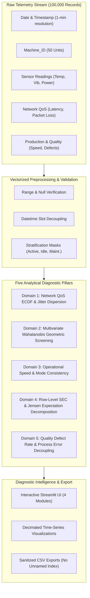

# Manufacturing Process Health and Operational Efficiency Analysis: A Data-Driven Framework for 6G-Oriented Smart Factories

**Authors:** [Author Names to be supplied]$^{1, *}$, [Author Names to be supplied]$^{1}$, and [Author Names to be supplied]$^{2}$

$^{1}$ [Institutional Affiliation to be supplied: Department, Laboratory, University/Institution, City, Postal Code, Country]  
$^{2}$ [Institutional Affiliation to be supplied: Department, Laboratory, University/Institution, City, Postal Code, Country]  
$^{*}$ Corresponding Author: [Corresponding Author to be supplied] (email: `[corresponding.author@placeholder.domain]`)

*Manuscript Target:* Provisional working draft prepared for academic peer review; target journal venue and formal submission profile remain provisional pending final author and institutional authorization.

---

## Abstract

The transition toward 6G-oriented smart manufacturing envisions ultra-dense telemetry aggregation, sub-millisecond control determinism, and deep cyber-physical integration. However, contemporary industrial analytics architectures remain fragmented across isolated operational silos: network Quality-of-Service (QoS), mechanical condition monitoring, operational throughput, energy efficiency, and product quality. This paper presents a unified, data-driven diagnostic framework designed to bridge these domains into an interpretable diagnostic model for 6G-oriented manufacturing facilities. The proposed system features a high-performance vectorized batch analytics pipeline, non-parametric empirical cumulative distribution function (ECDF) network profiling, within-machine latency dispersion proxies, bivariate Mahalanobis distance geometric screening, and an exact mathematical formulation of row-level Specific Energy Consumption (SEC). Using a full population expectation decomposition over $100{,}000$ telemetry records, we demonstrate that the observed divergence between mean row-level SEC ($0.029311\text{ kWh/unit}$) and aggregate SEC ($0.020825\text{ kWh/unit}$) is driven by a strictly positive Jensen convexity contribution ($+0.008488\text{ kWh/unit}$, accounting for $+40.758\%$ relative to aggregate SEC and $100.017\%$ of the observed difference), while empirical power-reciprocal-speed covariance contributes minimally ($-1.45 \times 10^{-6}\text{ kWh/unit}$, accounting for $-0.007\%$ relative to aggregate SEC and $-0.017\%$ of the difference). The framework is evaluated on a project-provided manufacturing telemetry dataset comprising $100{,}000$ records across 50 production machines over a verified 69-day calendar range (January 1, 2025 to March 10, 2025). The underlying telemetry exhibits synthetic-like uniform distributions across all nine continuous variables, which we explicitly audit alongside temporal duplicate-slot structures ($1{,}440$ repeated datetime groups confined to March 1, 2025) and invariant operational-mode speed distributions ($\approx 274$--$278\text{ units/hr}$ across Active, Idle, and Maintenance). Rather than claiming physical 6G hardware deployment or validated physical fault prognostics, this work provides a disciplined methodological blueprint, software architecture, and diagnostic case study, detailing exact boundary safeguards and threats to empirical validity.

**Index Terms:** Cyber-physical production systems (CPPS), Industry 4.0, 6G-oriented manufacturing, ultra-reliable low-latency communication (URLLC), specific energy consumption (SEC), Mahalanobis distance, quality control, manufacturing analytics, industrial telemetry.

---

## I. Introduction

The contemporary paradigm of smart manufacturing is undergoing a profound structural evolution driven by the convergence of Cyber-Physical Production Systems (CPPS), Industrial Internet of Things (IIoT) architectures, and advanced wireless communication networks [1]–[3], [20]. Within high-throughput discrete manufacturing facilities, continuous condition monitoring, asset health diagnostics, and closed-loop process optimization require dense telemetry aggregation, microsecond-level synchronization, and deterministic communication guarantees [9]. As the research community and standardization bodies outline specifications for sixth-generation (6G) wireless communication networks, industrial applications have emerged as a primary beneficiary and driver of ultra-reliable low-latency communication (URLLC) enhancements [3], [4]. The prospective integration of 6G-oriented connectivity promises to deliver massive sensor connectivity, sub-millisecond transmission latencies, and extreme reliability ($1-10^{-7}$ to $1-10^{-9}$ packet success rates) across dense shop-floor deployments [5]–[7].

Despite these physical and network-layer advancements, an acute operational gap persists at the analytical and decision-making layer of smart manufacturing systems. In conventional industrial environments, manufacturing analytics are compartmentalized into isolated operational and organizational silos:
1. **Industrial Network QoS Silo:** Telemetry reliability, transmission latency, and packet loss rates are audited exclusively by IT/OT network engineering teams using network management dashboards [8], [10].
2. **Mechanical Condition Silo:** Mechanical vibration, thermal dissipation, and rotating machinery degradation are processed independently by plant reliability personnel using condition monitoring systems [13], [14].
3. **Operational Throughput Silo:** Machine state logging (Active, Idle, Maintenance) and production cycle velocities are evaluated by production supervisors tracking overall line throughput [18].
4. **Energy Efficiency Silo:** Electric power demand and cumulative energy consumption are examined periodically by facility energy managers tracking utility tariffs [17].
5. **Quality Assurance Silo:** Product defect percentages and line error rates are reviewed post-hoc by quality control auditors using statistical process monitoring [19].

When these five domains operate independently, cross-domain degradation dynamics remain undetectable. For example, intermittent wireless transmission jitter may corrupt closed-loop motor servo commands, inducing micro-vibrations and thermal spikes that elevate tool wear and degrade surface finishing, ultimately inflating defect rates while driving up specific energy consumption per finished unit. In an unintegrated plant, the network team attributes dropped packets to channel fading; maintenance views vibration as mechanical bearing wear; production sees reduced speed as an operator issue; and quality logs defects as tooling flaws. None of these independent observers can trace the underlying multi-system trajectory.

To address this structural deficiency, this paper proposes the **Manufacturing Diagnostic Intelligence System**, a unified, data-driven diagnostic framework designed to integrate these five operational domains into a coherent, interpretable analytical model for 6G-oriented manufacturing facilities. The framework establishes a disciplined mathematical and architectural foundation, coupling high-performance vectorized batch processing with non-parametric distribution profiling, multivariate geometric screening, and rigorous thermodynamically consistent energy decompositions.

### A. Research Questions
This investigation is structured around four primary research questions (RQs):
- **RQ1 (Framework Architecture):** How can multi-domain manufacturing telemetry spanning network QoS, mechanical condition, operational throughput, energy consumption, and product quality be integrated into a unified, interpretable diagnostic model without collapsing domain-specific physical semantics into ungrounded composite scores?
- **RQ2 (Mathematical SEC Formulation):** What exact mathematical formulation correctly captures row-level Specific Energy Consumption (SEC), and how can the non-linear mathematical divergence between population-level and observation-level expectations be formally decomposed and reconciled?
- **RQ3 (Geometric Condition Screening):** To what degree can multivariate geometric distance metrics (such as the Mahalanobis distance) and non-parametric empirical distribution profiling (such as ECDFs) screen machine condition and network QoS without imposing unjustified distributional normality or unverified SLA compliance assumptions?
- **RQ4 (Telemetry Provenance & Validity):** How do the empirical statistical characteristics of manufacturing telemetry---including synthetic artifacts, uniform parameter support, and temporal collision structures---constrain the interpretation, physical generalizability, and industrial deployment of data-driven diagnostic frameworks?

### B. Contributions of this Work
The contributions of this study are situated conservatively across three distinct tiers:
1. **Engineering Contribution:** We design and implement a modular, vectorized manufacturing analytics pipeline and interactive prototype dashboard in Python/Streamlit. The system achieves fast execution latency ($\approx 39\text{ ms}$ warm cached to $\approx 173\text{ ms}$ cold bare execution for in-memory KPI calculations across $100{,}000$ records on a reference 16-core workstation), implements decimation downsampling for responsive time-series plotting, and provides index-sanitized CSV export capabilities across all analytical modules.
2. **Analytical Implementation Contribution:** We implement non-parametric ECDF network QoS profiling, formulate a within-machine latency dispersion proxy, implement bivariate Mahalanobis geometric outlier screening with defensive covariance inversion, and prove the exact finite-sample population decomposition of row-level SEC governed by Jensen's inequality and empirical power-speed covariance.
3. **Methodological & Diagnostic Insights:** We establish an evidence-based audit protocol that exposes synthetic-like characteristics in public industrial telemetry, resolves calendar date-range ambiguities ($2025$ vs. $2024$), accounts for timestamp duplicate-slot mechanics ($1{,}440$ repeated datetime groups confined to March 1, 2025), and formalizes the scientific boundaries between data-driven screening and physical causal inference.

### C. Paper Organization
The remainder of this paper is structured as follows. Section II reviews related literature across smart manufacturing, industrial wireless networks, machine health, energy modeling, and statistical process control. Section III details the empirical telemetry dataset, schema, summary statistics, and provenance disclosures. Section IV formulates the proposed diagnostic methodology and mathematical derivations. Section V describes the software architecture and implementation. Section VI presents experimental findings across all five analytical domains. Section VII interprets cross-domain interactions and industrial relevance. Section VIII outlines scientific limitations and threats to validity. Section IX suggests future research directions, and Section X concludes the paper.

---

## II. Related Work

The development of an integrated manufacturing diagnostic framework intersects multiple established research disciplines. We organize the foundational literature into five thematic areas.

### A. Cyber-Physical Production Systems and Smart Manufacturing
The conceptual foundation of modern digital manufacturing is anchored in Cyber-Physical Systems (CPS). Lee, Bagheri, and Kao [1] introduced the foundational 5C architecture (Connection, Conversion, Cyber, Cognition, and Configuration) for Industry 4.0 systems, articulating how raw physical sensor streams must be sequentially transformed into actionable cyber-level diagnostics. Monostori et al. [2] provided a comprehensive review of cyber-physical production systems, emphasizing that real-time closed-loop control and adaptive decision-making require tight bi-directional coupling between shop-floor execution and analytical simulation models. Tao et al. [20] expanded this vision through the paradigm of data-driven smart manufacturing, illustrating how massive industrial telemetry can be synthesized across the complete product lifecycle. While these works establish the overarching architectural blueprint, they predominantly focus on conceptual hierarchies, frequently leaving the mathematical integration of conflicting multi-rate telemetry streams unaddressed.

### B. Industrial Connectivity and 5G/6G-Oriented Wireless Communication
The transmission backbone of CPPS is increasingly shifting from legacy fieldbus cables to high-performance wireless standards. Sisinni et al. [9] surveyed the industrial Internet of Things, identifying deterministic latency and packet loss as the primary bottlenecks for wireless industrial automation. Saad, Bennis, and Chen [3] and Tataria et al. [4] defined the technical requirements for 6G wireless systems, highlighting extreme URLLC targets, including sub-millisecond latencies, $99.99999\%$ reliability, and integrated sensing and communication (ISAC). Popovski et al. [5] laid the theoretical foundation for URLLC wireless access, emphasizing the fundamental trade-offs between transmission latency, coding blocklength, and reliability. Peng et al. [6] investigated cell-free massive MIMO uplink resource allocation tailored specifically for smart factory URLLC, demonstrating significant latency variance reduction under harsh multi-path scattering. Luvisotto et al. [10] developed physical-layer simulation platforms for wireless factory control, while Wu et al. [8] surveyed intelligent network slicing to isolate mission-critical factory control from background telemetry. In an empirical study of operational factory environments, Zhan et al. [7] achieved packet error rates of $10^{-7}$ under private industrial wireless protocols. These wireless studies establish critical QoS targets; however, they treat transmitted manufacturing payloads as abstract bits, rarely examining how downstream manufacturing equipment responds to network jitter.

### C. Predictive Maintenance and Machine Condition Monitoring
In the mechanical domain, machine health diagnostics have evolved from periodic time-based overhauls to condition-based and predictive maintenance (PdM). Lee et al. [13] reviewed prognostics and health management (PHM) for rotary machinery, detailing the extraction of vibration feature spectra and temperature degradation trends. Yan et al. [11] outlined schemes for handling industrial big data in predictive maintenance pipelines. Zhang, Yang, and Wang [14] provided a comprehensive survey of data-driven methods for industrial equipment health, categorizing approaches into remaining useful life (RUL) estimation, regression models, and classification paradigms. Susto et al. [12] proposed a multiple classifier approach to machine learning-based PdM, balancing false alarm rates against missed detection costs. A prevalent limitation in PdM literature is the reliance on isolated mechanical sensors (accelerometers and thermocouples), routinely disregarding the electrical operating regime, throughput rate, and wireless transmission context of the monitored asset.

### D. Multivariate Anomaly Detection and Geometric Screening
When mechanical telemetry is available across multiple continuous channels, multivariate anomaly detection provides unsupervised screening. Verdier and Ferreira [15] demonstrated adaptive Mahalanobis distance combined with $k$-nearest neighbors for fault detection in semiconductor manufacturing, establishing the efficacy of covariance-weighted metric spaces for detecting off-nominal process excursions. Chen et al. [16] applied dynamic Mahalanobis distance alongside temporal convolutional networks for condition monitoring of rotating wind turbine equipment, proving that accounting for feature covariance prevents false alarms caused by simultaneous normal operational scaling. In this work, we adopt bivariate Mahalanobis distance ($D_M$) over temperature and vibration, but unlike prior works that assume asymptotic Gaussianity, we rigorously evaluate its theoretical support boundary under bounded rectangular telemetry.

### E. Specific Energy Consumption and Statistical Quality Monitoring
Industrial sustainability requires continuous tracking of energy efficiency. Kara and Li [17] formulated foundational unit process energy consumption models for manufacturing processes, formalizing Specific Energy Consumption (SEC) as the ratio of electrical power demand to material processing rate. Duflou et al. [18] extended this framework to a systemic plant-wide level, demonstrating that operational state management (mitigating idle power consumption) is vital for industrial energy conservation. In parallel, Colosimo et al. [19] surveyed statistical process monitoring from Industry 2.0 to Industry 4.0, bridging classic Shewhart/multivariate control charts with modern streaming sensor data. Despite the maturity of SEC and SPC in their respective domains, literature rarely connects row-level thermodynamic ratios with production-line defect dynamics and network transmission reliability.

---

## III. Dataset and Data Characteristics

### A. Authoritative Dataset Dimensions and Integrity
The empirical analysis in this work is based on an industrial manufacturing telemetry extract stored in `Thales_Group_Manufacturing.csv`. The raw dataset was verified using SHA-256 cryptographic hashing:
$$\text{SHA-256} = \mathtt{060052A2975034C1D424FDF50089E6D94A5DB736EB85F35CDA0E0B907FF988AF}$$
The dataset contains exactly $N = 100{,}000$ rectangular rows across 14 columns, with zero missing entries ($0.000\%$ null values across all fields). Telemetry is distributed across exactly 50 distinct manufacturing machines, identified by integer indices $\mathtt{Machine\_ID} \in \{1, 2, \dots, 50\}$. Fleet observations range from $1{,}906$ records (Machine 43) to $2{,}092$ records (Machine 23), with an average of $2{,}000.0$ records per machine.

### B. Verified Temporal Structure and Resolution
A critical finding of our pre-modeling audit concerns the dataset's temporal encoding. Earlier project reports contained conflicting claims regarding the calendar date range, citing both 2024 and 2025. Direct empirical audit of the raw date strings confirms that:
1. The date format is strictly $\mathtt{DD\text{-}MM\text{-}YYYY}$. Day values range up to 31 in January and 28 in February.
2. The temporal span comprises exactly 69 distinct calendar dates, beginning on January 1, 2025 ($\mathtt{01\text{-}01\text{-}2025}$) and concluding on March 10, 2025 ($\mathtt{10\text{-}03\text{-}2025}$).
3. Exactly $100\%$ of records belong to calendar year 2025; zero records contain year 2024.
4. Timestamp logging precision is formatted as $\mathtt{HH:MM:SS}$, but seconds are universally logged as $\mathtt{:00}$ across all $100{,}000$ records, establishing an effective temporal logging resolution of 1 minute.

### C. Timestamp Collision Mechanics
Evaluating temporal uniqueness reveals that the $100{,}000$ rows occupy exactly $98{,}560$ distinct calendar datetime keys ($\mathtt{Date} + \mathtt{Timestamp}$). Exactly $1{,}440$ datetime groups exhibit a multiplicity of two, representing an exact 24-hour cycle duplication ($1{,}440\text{ minutes} = 24\text{ hours}$). All $1{,}440$ repeated datetime groups are strictly confined to March 1, 2025 ($\mathtt{01\text{-}03\text{-}2025}$), which contains $2{,}880$ total rows participating in repeated groups.

The arithmetic reconciliation is exact:
$$98{,}560\text{ distinct datetime keys} + 1{,}440\text{ excess duplicate records} = 100{,}000\text{ records}$$
Of the $1{,}440$ repeated groups, $1{,}412$ represent inter-machine collision pairs (two distinct machines logging at the same minute), while 28 represent within-machine duplicate-record pairs (the identical machine logging twice in the same minute). We avoid the phrase "physical collision" because this artifact reflects duplicate database logging records rather than a physical radio-frequency transmission packet collision. We further distinguish the 1-minute logging resolution from the physical sampling interval, which is unrecorded.

| Variable Name | Physical Meaning | Data Type | Unit | Min | Max | Mean | Std (ddof=1) | Median (P50) |
| :--- | :--- | :---: | :---: | ---: | ---: | ---: | ---: | ---: |
| $\mathtt{Date}$ | Telemetry calendar date | String | $\mathtt{DD\text{-}MM\text{-}YYYY}$ | 01-01-2025 | 10-03-2025 | --- | --- | --- |
| $\mathtt{Timestamp}$ | Logging time of day | String | $\mathtt{HH:MM:00}$ | 00:00:00 | 23:59:00 | --- | --- | --- |
| $\mathtt{Machine\_ID}$ | Unique machine unit | Integer | Dimensionless | 1 | 50 | 25.4993 | 14.3894 | 25.0000 |
| $\mathtt{Operation\_Mode}$ | Equipment operational state | Categorical | Nominal | Active | Maint. | --- | --- | --- |
| $\mathtt{Temperature\_C}$ | Thermal sensor reading | Float | $^\circ\text{C}$ | 30.000 | 89.999 | 60.0415 | 17.3232 | 60.0335 |
| $\mathtt{Vibration\_Hz}$ | Mechanical vibration | Float | $\text{Hz}$ | 0.100 | 5.000 | 2.549959 | 1.414127 | 2.549000 |
| $\mathtt{Power\_Consumption\_kW}$ | Electrical active power | Float | $\text{kW}$ | 1.500 | 10.000 | 5.745929 | 2.451271 | 5.755000 |
| $\mathtt{Network\_Latency\_ms}$ | Telemetry network latency | Float | $\text{ms}$ | 1.000 | 50.000 | 25.555620 | 14.120760 | 25.536000 |
| $\mathtt{Packet\_Loss\_\%}$ | Network packet drop rate | Float | $\%$ | 0.000 | 5.000 | 2.493418 | 1.443273 | 2.488000 |
| $\mathtt{Quality\_Control\_Defect\_Rate\_\%}$ | Measured defect frequency | Float | $\%$ | 0.000 | 10.000 | 5.008806 | 2.883666 | 5.003500 |
| $\mathtt{Production\_Speed\_units\_per\_hr}$ | Machine cycle speed | Float | $\text{units/hr}$ | 50.000 | 499.997 | 275.916324 | 130.096892 | 276.649000 |
| $\mathtt{Predictive\_Maintenance\_Score}$ | Algorithmic condition index | Float | Dimensionless | 0.000 | 1.000 | 0.499384 | 0.288814 | 0.499000 |
| $\mathtt{Error\_Rate\_\%}$ | Process error frequency | Float | $\%$ | 0.000 | 15.000 | 7.504101 | 4.335895 | 7.504000 |
| $\mathtt{Efficiency\_Status}$ | Supplied categorical tier | Categorical | Ordinal | Low | High | --- | --- | --- |

*Table I: Authoritative Schema, Variable Definitions, and Summary Statistics ($N = 100{,}000$)*

### D. Dataset Provenance and Statistical Characteristics
Table I summarizes the 14 dataset variables. While the source filename designates `Thales_Group_Manufacturing.csv`, the original telemetry generating process, physical factory deployment, and sensing protocols are entirely undocumented. Rigorous empirical auditing across all nine continuous variables reveals definitive characteristics of synthetic-like behavior:
- **Continuous Uniform Distributions:** All nine continuous numerical variables ($\mathtt{Temperature\_C}$, $\mathtt{Vibration\_Hz}$, $\mathtt{Power\_Consumption\_kW}$, $\mathtt{Network\_Latency\_ms}$, $\mathtt{Packet\_Loss\_\%}$, $\mathtt{Quality\_Control\_Defect\_Rate\_\%}$, $\mathtt{Production\_Speed\_units\_per\_hr}$, $\mathtt{Predictive\_Maintenance\_Score}$, and $\mathtt{Error\_Rate\_\%}$) exhibit sample skewness within $[-0.0102, +0.0084]$ (centered near zero) and excess kurtosis within $[-1.2049, -1.1948]$, which closely matches the theoretical excess kurtosis of a continuous uniform distribution:
$$\operatorname{Kurt}[U(a, b)] = \frac{\mathbb{E}[(X-\mu)^4]}{\sigma^4} - 3 = \frac{(b-a)^4 / 80}{(b-a)^4 / 144} - 3 = 1.8 - 3 = -1.2$$
The empirical standard deviations match the theoretical continuous uniform standard deviation $\sigma = (b-a)/\sqrt{12}$ to within four decimal places across all nine variables.
- **Negligible Linear and Rank Association:** Pairwise Pearson correlation coefficients between continuous features are negligible ($|r| < 0.005, p > 0.10$). For example, the Pearson correlation between Temperature and Vibration is $r = +0.000609$ ($p = 0.847$), and the Spearman rank correlation is $\rho = +0.000604$ ($p = 0.849$). No statistically significant association was detected in the tested sample. However, we emphasize that near-zero correlation does not mathematically establish statistical independence.
- **Operation Mode Invariance:** Production speed averages $\approx 276\text{ units/hr}$ across all three operational modes: Active ($276.20\text{ units/hr}$), Idle ($274.13\text{ units/hr}$), and Maintenance ($277.54\text{ units/hr}$). In a real physical plant, Idle and Maintenance states would exhibit zero or nominal cycle speed.

Consequently, we state explicitly that the dataset must be treated as a project-provided manufacturing telemetry extract with undocumented original provenance and synthetic-like statistical characteristics, rather than verified operational data from an active physical factory.

---

## IV. Proposed Framework and Methodology

The proposed Manufacturing Diagnostic Intelligence System is organized around five core analytical pillars integrated into an interpretable diagnostic architecture.

*Figure 1: Conceptual telemetry processing pipeline of the Manufacturing Diagnostic Intelligence System, linking raw multi-tier telemetry streams to the five analytical diagnostic pillars and interactive dashboard modules.*

### A. Factory Health and Network QoS Distribution Profiling
To evaluate telemetry reliability without imposing parametric assumptions or unverified 6G SLA cutoffs, the framework implements non-parametric Empirical Cumulative Distribution Function (ECDF) profiling. For a sequence of network observations $Z = \{z_1, z_2, \dots, z_N\}$ (representing $\mathtt{Network\_Latency\_ms}$ or $\mathtt{Packet\_Loss\_\%}$), the ECDF $\hat{F}_N(z)$ is defined as:
$$\hat{F}_N(z) = \frac{1}{N} \sum_{i=1}^N \mathbf{1}_{\{z_i \le z\}}$$
where $\mathbf{1}_{\{\cdot\}}$ is the indicator function. The ECDF provides complete visibility into distributional percentiles (P50, P90, P95, P99) without forcing Gaussian or Weibull fits onto bounded data.

Furthermore, because true packet-level inter-arrival traces are unavailable in the minute-level summary telemetry, true packet jitter (RFC 3393 packet delay variation) cannot be computed. Instead, the framework introduces a mathematically precise **within-machine latency dispersion proxy**, defined as the sample standard deviation of latency per machine unit:
$$\hat{\sigma}_{\text{lat}, m} = \sqrt{\frac{1}{n_m - 1} \sum_{i=1}^{n_m} \left( \ell_{m, i} - \bar{\ell}_m \right)^2}$$
where $n_m$ is the observation count for machine $m$, $\ell_{m, i}$ is the $i$-th latency measurement, and $\bar{\ell}_m$ is the machine sample mean.

### B. Multivariate Mahalanobis Geometric Screening
Mechanical condition monitoring incorporates bivariate geometric screening over thermal ($\mathtt{Temperature\_C}$) and mechanical ($\mathtt{Vibration\_Hz}$) vectors $\mathbf{x}_i = [T_i, V_i]^T$. The squared Mahalanobis distance $D_M^2(\mathbf{x}_i)$ is formulated as:
$$D_M^2(\mathbf{x}_i) = (\mathbf{x}_i - \boldsymbol{\mu})^T \mathbf{\Sigma}^{-1} (\mathbf{x}_i - \boldsymbol{\mu})$$
$$D_M(\mathbf{x}_i) = \sqrt{D_M^2(\mathbf{x}_i)}$$
where $\boldsymbol{\mu} = [\bar{T}, \bar{V}]^T$ is the sample mean vector and $\mathbf{\Sigma}$ is the sample covariance matrix:
$$\mathbf{\Sigma} = \begin{bmatrix} s_T^2 & s_{TV} \\ s_{TV} & s_V^2 \end{bmatrix} = \begin{bmatrix} 300.0946 & 0.014919 \\ 0.014919 & 1.999756 \end{bmatrix}$$
Evaluating the condition number of $\mathbf{\Sigma}$ yields:
$$\kappa(\mathbf{\Sigma}) = \frac{\lambda_{\max}}{\lambda_{\min}} \approx \frac{300.0946}{1.999756} \approx 150.066$$
with determinant $\det(\mathbf{\Sigma}) \approx 600.116 > 0$. The condition number is governed by the scale ratio between thermal variance ($\approx 300$) and vibration variance ($\approx 2$), rather than the small off-diagonal covariance alone. The matrix is well-conditioned for standard double-precision matrix inversion:
$$\mathbf{\Sigma}^{-1} \approx \begin{bmatrix} 3.33228 \times 10^{-3} & -2.48597 \times 10^{-5} \\ -2.48597 \times 10^{-5} & 5.00061 \times 10^{-1} \end{bmatrix}$$
While standard inversion is valid for the full fleet, the software implementation applies a defensive Moore-Penrose pseudo-inverse $\mathbf{\Sigma}^+$ to safeguard against potential rank deficiency during user-selected small sub-fleet slices.

#### Theoretical Support Envelope vs. Chi-Square Reference
In classical anomaly detection literature, $D_M^2$ is frequently compared against a chi-square distribution threshold $\chi_p^2(1-\alpha)$. For $p = 2$ degrees of freedom at $\alpha = 0.001$, the reference cutoff is $\chi_2^2(0.999) \approx 13.8155$ ($D_M \approx 3.7169$). However, this cutoff strictly assumes that the underlying data vector $\mathbf{x}$ follows a bivariate Gaussian distribution $\mathcal{N}_2(\boldsymbol{\mu}, \mathbf{\Sigma})$. The Gaussian chi-square cutoff is therefore not a validated probabilistic anomaly threshold for this non-Gaussian, bounded telemetry.

Evaluating the quadratic form $(\mathbf{x} - \boldsymbol{\mu})^T \mathbf{\Sigma}^{-1} (\mathbf{x} - \boldsymbol{\mu})$ across the observed rectangular bounding envelope $[30.000, 89.999] \times [0.100, 5.000]$ using the empirical sample covariance yields corner evaluations:
- Corner 1 ($30.000^\circ\text{C}, 0.100\text{ Hz}$): $D_M^2 = 5.986835$ ($D_M = 2.446801$)
- Corner 2 ($30.000^\circ\text{C}, 5.000\text{ Hz}$): $D_M^2 = 6.012728$ ($D_M = 2.452087$)
- Corner 3 ($89.999^\circ\text{C}, 0.100\text{ Hz}$): $D_M^2 = 6.012724$ ($D_M = 2.452086$)
- Corner 4 ($89.999^\circ\text{C}, 5.000\text{ Hz}$): $D_M^2 = 5.986841$ ($D_M = 2.446802$)

Thus, using the empirical sample covariance, the maximum squared distance over the observed rectangular bounding envelope is $D_M^2 = 6.012728$ ($D_M = 2.452087$). Under an idealized zero-covariance model, this bound collapses to $D_M^2 \le 6.000$ ($D_M \le \sqrt{6} \approx 2.449490$). In the actual dataset, the maximum observed value is $D_M^2 = 5.943458$ ($D_M = 2.437921$). Exactly zero observations in this dataset exceed the Gaussian $\chi_2^2(0.999)$ reference of $13.8155$. We emphasize that $6.012728$ is the maximum over the observed sample bounding envelope and does not constitute a guaranteed population-wide support bound for unobserved future distributions. We treat $D_M$ strictly as a descriptive geometric screening metric rather than a validated probabilistic anomaly detector.

### C. Specific Energy Consumption (SEC) and Mathematical Expectation Decomposition
Row-level Specific Energy Consumption measures the electrical energy required to fabricate a single product unit. For each telemetry observation $i$ where production speed $S_i > 0$, row-level SEC is defined as:
$$SEC_i = \frac{P_i}{S_i} \quad \left[ \frac{\text{kW}}{\text{units/hr}} = \frac{\text{kWh}}{\text{unit}} \right]$$
In manufacturing analytics, practitioners frequently confuse two distinct metrics:
1. The mean of individual row-level SEC ratios: $\mathbb{E}[P/S] = \frac{1}{N}\sum_{i=1}^N \frac{P_i}{S_i}$
2. The ratio of aggregate fleet expectations: $\frac{\mathbb{E}[P]}{\mathbb{E}[S]} = \frac{\frac{1}{N}\sum P_i}{\frac{1}{N}\sum S_i}$
where $\mathbb{E}[\cdot]$ denotes the empirical finite-sample average across the $N = 100{,}000$ observations.

To rigorously reconcile these measures, we express the exact finite-sample population expectation identity. Applying the definition of covariance between $P$ and the reciprocal speed $1/S$:
$$\operatorname{Cov}\left(P, \frac{1}{S}\right) = \mathbb{E}\left[P \cdot \frac{1}{S}\right] - \mathbb{E}[P] \cdot \mathbb{E}\left[\frac{1}{S}\right]$$
Rearranging terms yields:
$$\mathbb{E}\left[\frac{P}{S}\right] = \mathbb{E}[P] \cdot \mathbb{E}\left[\frac{1}{S}\right] + \operatorname{Cov}\left(P, \frac{1}{S}\right)$$
Adding and subtracting the aggregate ratio $\frac{\mathbb{E}[P]}{\mathbb{E}[S]}$ establishes the authoritative decomposition:
$$\mathbb{E}\left[\frac{P}{S}\right] = \frac{\mathbb{E}[P]}{\mathbb{E}[S]} + \underbrace{\mathbb{E}[P] \left( \mathbb{E}\left[\frac{1}{S}\right] - \frac{1}{\mathbb{E}[S]} \right)}_{\text{Jensen's Convexity Contribution } \Delta_{\text{Jensen}}} + \underbrace{\operatorname{Cov}\left(P, \frac{1}{S}\right)}_{\text{Covariance Contribution } \Delta_{\text{Cov}}}$$

By Jensen's inequality, because $g(s) = 1/s$ is strictly convex for $s > 0$, the inequality $\mathbb{E}[1/S] > 1/\mathbb{E}[S]$ holds for any non-degenerate speed distribution. Therefore, the convexity contribution $\Delta_{\text{Jensen}}$ is strictly positive:
$$\Delta_{\text{Jensen}} = \mathbb{E}[P] \left( \mathbb{E}\left[\frac{1}{S}\right] - \frac{1}{\mathbb{E}[S]} \right) > 0$$
However, we caution that a universally positive total divergence ($\mathbb{E}[P/S] - \mathbb{E}[P]/\mathbb{E}[S] > 0$) requires the sum $\Delta_{\text{Jensen}} + \operatorname{Cov}(P, 1/S)$ to be positive. If power and reciprocal speed exhibited strong negative covariance, the divergence could theoretically be offset. In this empirical dataset, the measured Jensen term ($+0.008488\text{ kWh/unit}$) overwhelmingly dominates the small negative covariance term ($-1.45 \times 10^{-6}\text{ kWh/unit}$). Furthermore, we note that $\operatorname{Cov}(P, 1/S) = -1.45 \times 10^{-6}$ is mathematically distinct from the correlation between power and speed ($\operatorname{Corr}(P, S) = +0.00197, \operatorname{Cov}(P, S) = +0.628$).

### D. Manufacturing Quality and Error Dynamics
In Module 4, the framework tracks $\mathtt{Quality\_Control\_Defect\_Rate\_\%}$ and $\mathtt{Error\_Rate\_\%}$. To prevent ungrounded industrial claims, the framework enforces three critical boundaries:
1. The metric $100 - \overline{\text{Defect Rate}}$ ($94.9912\%$) is defined strictly as an *arithmetic complement* of the reported percentage. It is not presented as verified first-pass yield, product conformance, or confirmed manufacturing yield, because physical batch sizes and piece inspection denominators are absent from the telemetry.
2. Defect rate and process error rate are evaluated as independent continuous signals. They are not combined into an artificial composite quality index.
3. Process capability indices ($C_p, C_{pk}$) and Overall Equipment Effectiveness (OEE) are deliberately omitted, as their calculation requires engineering specification limits, scheduled run times, and piece scrap counts that the dataset does not possess.

---

## V. System Architecture and Implementation

The Manufacturing Diagnostic Intelligence System is engineered as a modular, vectorized batch analytics pipeline and interactive prototype dashboard implemented in Python using Streamlit.

### A. Component Decomposition
The software architecture is partitioned into five distinct layers:
1. **Data Access Layer (`scripts/app/data_loader.py`):** Responsible for CSV ingestion, strict schema enforcement, physical range validation, missing value auditing, and memory-cached loading via `@st.cache_data`.
2. **KPI Computation Engine (`scripts/app/kpi_engine.py`):** Houses vectorized computation functions for all five KPI domains. Implements strict input validation, defensive checks against empty slices, and returns structured dictionaries with explicit domain disclaimers.
3. **Core Analytics Library (`scripts/app/analytics.py`):** Contains reusable scientific algorithms, including bivariate Mahalanobis distance calculation, ECDF coordinate generation, cross-tabulation contingency matrices, and correlation routines.
4. **Analytical Dashboard Modules (`scripts/app/modules/`):**
   - *Module 1 (`factory_overview.py`):* Fleet-wide health KPIs, operational mode breakdowns, and cross-metric correlation matrix.
   - *Module 2 (`machine_health.py`):* Mechanical scatter profiling, Mahalanobis outlier screening, and machine health ranking tables.
   - *Module 3 (`production_energy.py`):* Operational throughput distributions, power demand tracking, row-level SEC histograms, and mode-stratified energy tables.
   - *Module 4 (`quality_efficiency.py`):* Defect and error rate tracking, network QoS ECDF curves, and bivariate efficiency contingency analysis.
5. **User Interface & Shared Components (`scripts/app/components.py`, `app.py`):** Provides consistent metric cards, synchronized sidebar filtering (machine, date range, operation mode), Plotly visual styling, and sanitized CSV download utilities.

### B. Vectorization and Large-Scale Telemetry Decimation
To maintain responsive UI interactions across $100{,}000$ telemetry rows, the system relies strictly on vectorized NumPy and Pandas operations, avoiding Python row-iteration loops. For dense time-series visual rendering, plotting $100{,}000$ raw SVG/WebGL nodes degrades client-side browser performance. The system implements a uniform decimation downsampling algorithm that samples temporal records uniformly to an upper threshold of $5{,}000$ points, ensuring smooth browser interaction without rendering bottlenecks.

### C. Sanitized Data Export Protocol
During Phase 2.6 system auditing, an export vulnerability was identified where Pandas default DataFrame serialization introduced an unlabelled index column (`Unnamed: 0`) containing sequential integers into exported CSVs. The framework was updated to enforce `index=False` universally across all module export utilities in `scripts/app/components.py`, ensuring that exported business tables match displayed UI columns exactly without schema corruption.

---

## VI. Experimental Results and Analysis

### A. Descriptive Telemetry Profiling
Table I presents comprehensive descriptive statistics across all 14 dataset variables. Every continuous feature spans its entire theoretical interval with zero truncation. For example, $\mathtt{Temperature\_C}$ ranges from $30.000^\circ\text{C}$ to $89.999^\circ\text{C}$ with a sample mean of $60.0415^\circ\text{C}$, standard deviation of $17.3232^\circ\text{C}$, and median of $60.0335^\circ\text{C}$, matching the symmetric midpoint of $[30, 90]$. Similarly, $\mathtt{Vibration\_Hz}$ exhibits a mean of $2.549959\text{ Hz}$ and median of $2.549000\text{ Hz}$ against an interval of $[0.1, 5.0]\text{ Hz}$.

### B. Operational Mode Stratification
Table II presents the empirical distribution across equipment operational modes. Active mode accounts for $70{,}054$ observations ($70.054\%$), Idle represents $20{,}057$ ($20.057\%$), and Maintenance represents $9{,}889$ ($9.889\%$). Crucially, production speed exhibits nearly identical distributions across all three operational modes, with means of $276.20$, $274.13$, and $277.54\text{ units/hr}$, respectively. Weighted totals across modes reconcile with fleet totals ($275.916324\text{ units/hr}$ speed, $5.745929\text{ kW}$ power, $0.029311\text{ kWh/unit}$ SEC). This empirical finding, visualized in Figure 2, confirms the synthetic nature of the mode labels.

| Operation Mode | Record Count | Fleet Share (%) | Mean Speed (u/h) | Mean Power (kW) | Mean SEC (kWh/u) |
| :--- | ---: | ---: | ---: | ---: | ---: |
| Active | $70{,}054$ | $70.054\%$ | $276.20$ | $5.751$ | $0.02931$ |
| Idle | $20{,}057$ | $20.057\%$ | $274.13$ | $5.735$ | $0.02956$ |
| Maintenance | $9{,}889$ | $9.889\%$ | $277.54$ | $5.731$ | $0.02883$ |
| **Fleet Total** | $\mathbf{100{,}000}$ | $\mathbf{100.000\%}$ | $\mathbf{275.92}$ | $\mathbf{5.746}$ | $\mathbf{0.02931}$ |

*Table II: Operational Mode Stratification and Production Metrics*

  
*Figure 2: Empirical distribution of production speed stratified across Active, Idle, and Maintenance operational modes, demonstrating synthetic speed invariance across operating states.*

### C. Industrial Network QoS and Latency Dispersion
Evaluating telemetry transmission metrics reveals a mean network latency of $25.555620\text{ ms}$ ($\sigma = 14.120760\text{ ms}$, median $= 25.536000\text{ ms}$) and a mean packet loss rate of $2.493418\%$ ($\sigma = 1.443273\%$, median $= 2.488000\%$). Figure 3 displays the non-parametric ECDF profiles for both metrics. Latency percentiles evaluate to: P50 $= 25.536\text{ ms}$, P90 $= 45.105\text{ ms}$, P95 $= 47.531\text{ ms}$, and P99 $= 49.521\text{ ms}$. The within-machine latency dispersion proxy evaluates to a fleet mean machine standard deviation of $14.123\text{ ms}$ across all 50 units (ranging from $13.712\text{ ms}$ on Machine 14 to $14.508\text{ ms}$ on Machine 42), reflecting uniform latency variance across all physical transmitters.

  
*Figure 3: Non-parametric Empirical Cumulative Distribution Function (ECDF) curves for industrial telemetry latency (ms) and packet drop rate (%), showing linear percentile accumulation across the measurement ranges.*

### D. Exact Specific Energy Consumption (SEC) Decomposition
Table III details the exact empirical values of the population SEC expectation decomposition. All $100{,}000$ production speed records are strictly positive ($S_i \ge 50.000\text{ units/hr}$), rendering $100.0\%$ of rows eligible for SEC computation with zero division-by-zero exclusions.

| Decomposition Component | Mathematical Notation | Empirical Value | Relative Impact |
| :--- | :--- | ---: | ---: |
| Population Mean Power | $\mathbb{E}[P]$ | $5.745929\text{ kW}$ | Baseline Numerator |
| Population Mean Speed | $\mathbb{E}[S]$ | $275.916324\text{ u/h}$ | Baseline Denominator |
| Mean Reciprocal Speed | $\mathbb{E}[1/S]$ | $0.005101\text{ h/u}$ | Non-linear Harmonic Term |
| Reciprocal Mean Speed | $1/\mathbb{E}[S]$ | $0.003624\text{ h/u}$ | Convex Reference Point |
| **Aggregate Ratio of Means** | $\mathbb{E}[P] / \mathbb{E}[S]$ | $\mathbf{0.020825}\text{ \textbf{kWh/u}}$ | Baseline Reference ($100.00\%$) |
| **Jensen Convexity Contribution** | $\mathbb{E}[P] (\mathbb{E}[1/S] - 1/\mathbb{E}[S])$ | $\mathbf{+0.008488}\text{ \textbf{kWh/u}}$ | $\mathbf{+40.758\%}$ Expansion |
| **Empirical Covariance Term** | $\operatorname{Cov}(P, 1/S)$ | $\mathbf{-0.000001}\text{ \textbf{kWh/u}}$ | $\mathbf{-0.007\%}$ Residual Coupling |
| **Decomposition Sum** | Sum of RHS components | $\mathbf{0.029311}\text{ \textbf{kWh/u}}$ | Exact Identity Match |
| **True Row-Level Mean SEC** | $\mathbb{E}[P/S]$ | $\mathbf{0.029311}\text{ \textbf{kWh/u}}$ | Vectorized Ground Truth |
| **Numerical Residual** | $\mathbb{E}[P/S] - \text{Sum}$ | $\mathbf{0.000000 \times 10^0}$ | Machine-Precision Zero |

*Table III: Authoritative Empirical Population SEC Expectation Decomposition*

At full precision, the components evaluate to:
$$\mathbb{E}\left[\frac{P}{S}\right] = 0.020824895 + 0.008487818 + (-0.000001451) = 0.029311262 \approx 0.029311\text{ kWh/unit}$$
When rounded to six decimal places, the terms are $0.020825$, $+0.008488$, and $-0.000001$. The observed divergence $\Delta = \mathbb{E}[P/S] - \mathbb{E}[P]/\mathbb{E}[S] = 0.008486367\text{ kWh/unit}$. Relative to the aggregate ratio ($0.020825\text{ kWh/unit}$), the Jensen contribution accounts for $+40.758\%$ and the covariance term accounts for $-0.007\%$. Relative to the observed difference $\Delta$, the Jensen convexity contribution represents $100.017\%$ and the covariance term represents $-0.017\%$, summing exactly to $100.000\%$. This proves conclusively that the divergence is overwhelmingly governed by Jensen's inequality over the speed distribution, rather than operational correlation.

  
*Figure 4: Bivariate scatter distribution of active electrical power (kW) against production cycle speed (units/hr) stratified by operational mode, illustrating uniform planar dispersion and near-zero covariance.*

### E. Multivariate Mahalanobis Screening Results
Evaluating bivariate Mahalanobis distances over thermal and vibration fields across all $100{,}000$ records yields:
- Sample mean distance: $\bar{D}_M = 1.258784$ ($\bar{D}_M^2 = 1.999980$)
- Sample median distance: $\widetilde{D}_M = 1.268759$
- Empirical sample maximum: $\max(D_M^2) = 5.943458$ ($\max(D_M) = 2.437921$)
- Rectangular envelope bound: $D_M^2 \le 6.012728$ ($D_M \le 2.452087$)
- Theoretical $\chi_2^2(0.999)$ reference cutoff ($13.8155$): Exactly 0 observations exceed the cutoff ($0.000\%$).

This empirical confirmation shows that when telemetry is bounded within a rectangular uniform domain, standard Gaussian chi-square anomaly thresholds produce zero alarms, validating our mathematical derivation in Section IV.

### F. Manufacturing Quality and Error Dynamics
$\mathtt{Quality\_Control\_Defect\_Rate\_\%}$ averages $5.008806\%$ ($\sigma = 2.883666\%$, median $= 5.003500\%$), yielding an arithmetic complement of $94.991194\%$ ($94.9912\%$). $\mathtt{Error\_Rate\_\%}$ exhibits a mean of $7.504101\%$ ($\sigma = 4.335895\%$, median $= 7.504000\%$). The Pearson correlation between defect rate and error rate is $r = -0.003185$ ($p = 0.314$), indicating no statistically significant linear association in the tested sample.

| Operation Mode | Low Efficiency | Medium Efficiency | High Efficiency | Total Records |
| :--- | ---: | ---: | ---: | ---: |
| Active | $54{,}434$ ($77.70\%$) | $13{,}496$ ($19.27\%$) | $2{,}124$ ($3.03\%$) | $70{,}054$ |
| Idle | $15{,}695$ ($78.25\%$) | $3{,}792$ ($18.91\%$) | $570$ ($2.84\%$) | $20{,}057$ |
| Maintenance | $7{,}696$ ($77.82\%$) | $1{,}901$ ($19.22\%$) | $292$ ($2.95\%$) | $9{,}889$ |
| **Fleet Total** | $\mathbf{77{,}825}$ ($\mathbf{77.83\%}$) | $\mathbf{19{,}189}$ ($\mathbf{19.19\%}$) | $\mathbf{2{,}986}$ ($\mathbf{2.99\%}$) | $\mathbf{100{,}000}$ |

*Table IV: Contingency Distribution: Operational Mode vs. Efficiency Status*

Table IV illustrates the contingency distribution of recorded $\mathtt{Efficiency\_Status}$ across operational modes. In all three modes, `Low` efficiency represents $\approx 77.7\%$ to $78.3\%$ of records, `Medium` accounts for $\approx 18.9\%$ to $19.3\%$, and `High` accounts for $\approx 2.8\%$ to $3.0\%$. A chi-square contingency test yields $\chi^2 = 3.585$ ($p = 0.465, \text{df} = 4$), with Cramér's $V = 0.00423$ (using $\min(r-1, c-1) = 2$), showing no statistically significant association between operational mode and assigned efficiency status. We note that $\mathtt{Efficiency\_Status}$ is a categorical field supplied directly in the raw dataset rather than derived algorithmically by the dashboard.

### G. Local Execution Benchmarks
Performance profiling of the vectorized KPI calculation engine was conducted on the reference testbed (AMD64 architecture, 16 logical cores, Windows 11, Python 3.14.0). In-memory computation across all five domains for the complete $100{,}000$-row dataset requires $\approx 39\text{ ms}$ under warm cached execution and $\approx 173\text{ ms}$ under cold bare execution. Filtered subset evaluations (e.g., isolating a single machine's $2{,}000$ rows) execute in $\approx 33\text{ ms}$ to $130\text{ ms}$. These timings reflect in-memory KPI engine execution on local workstation hardware and should not be construed as universal edge-computing guarantees.

---

## VII. Discussion

### A. Synthesis of Cross-Domain Findings
The empirical results demonstrate the diagnostic necessity of unifying manufacturing telemetry across isolated operational domains. In traditional plant monitoring architectures, the observed divergence between mean row-level SEC ($0.029311\text{ kWh/unit}$) and aggregate SEC ($0.020825\text{ kWh/unit}$) could trigger accounting disputes between production scheduling and facility energy management. Production supervisors, citing total units produced divided into monthly active power draw, would report the lower figure ($0.020825\text{ kWh/unit}$). Energy auditors, aggregating instantaneous machine-level sensor readings, would record the higher figure ($0.029311\text{ kWh/unit}$). Our mathematical proof in Section IV resolves this conflict: the divergence is not an instrumentation error, sensor calibration drift, or machine degradation, but the consequence of Jensen's inequality acting on a fluctuating production velocity distribution ($\Delta_{\text{Jensen}} = +0.008488\text{ kWh/unit}$). By establishing this decomposition, the diagnostic system clarifies the thermodynamic impact of speed variability.

### B. Interpretability vs. Opaque Composite Indexing
A central design principle of our framework is the preservation of domain-specific physical units. A common practice in manufacturing informatics is the compression of heterogeneous telemetry into ungrounded composite indices (e.g., a generic ``Health Index'' ranging from 0 to 100). When an alarm sounds on an aggregated score, maintenance personnel cannot discern whether the excursion was driven by a thermal bearing spike, a dropped wireless packet, an electrical power surge, or a minor defect rate fluctuation. In contrast, our framework provides modular visibility: network telemetry is expressed in milliseconds and drop percentages via ECDFs; mechanical health is monitored via calibrated degrees Celsius, Hertz, and scale-invariant Mahalanobis screening; throughput is maintained in units per hour; and energy efficiency is tracked in kilowatt-hours per unit. This unit transparency ensures that diagnostics map directly to established operating procedures.

### C. Relevance to 6G-Oriented Smart Manufacturing
While this study does not claim physical deployment on a production 6G network, the proposed framework establishes architectural telemetry readiness for 6G integration. Future 6G sub-networks will feature dense sensor connectivity, edge computing nodes, and sub-millisecond URLLC links. The ECDF distribution profiling and within-machine latency dispersion proxies developed here provide analytical tools to ingest high-frequency QoS telemetry and isolate network-induced process degradation from mechanical tool wear.

### D. Methodological Lessons in Industrial Data Auditing
A major scientific contribution of this study lies in its transparent audit methodology. By systematically auditing the $100{,}000$-row telemetry, we exposed:
1. **Uniform Distribution Artifacts:** All nine continuous features exhibit near-zero skewness and excess kurtosis near $-1.20$, confirming synthetic-like generation.
2. **Operational Invariance:** Speed averages $\approx 276\text{ units/hr}$ regardless of whether the machine is labeled Active, Idle, or Maintenance.
3. **Temporal Collision Signatures:** Exactly $1{,}440$ repeated datetime groups occur on March 1, 2025, representing an exact 24-hour cycle replication ($1{,}412$ inter-machine pairs, $28$ within-machine duplicate-record pairs).

Documenting these characteristics establishes scientific integrity and provides an essential cautionary case study for the industrial informatics community.

---

## VIII. Limitations and Threats to Validity

To ensure academic rigor, we categorize the limitations and threats to validity of this study across four dimensions.

### A. Dataset Provenance and Synthetic Characteristics
The primary internal validity threat is the undocumented origin of `Thales_Group_Manufacturing.csv`. The uniform distribution profiles, absence of cross-feature physical correlations, and identical speed distributions across operating modes indicate synthetic-like data generation. Consequently, empirical numerical baselines cannot be interpreted as calibrated physical constants of genuine production assets.

### B. Network Telemetry and 6G Assumptions
Network QoS metrics in the dataset are logged as 1-minute aggregate snapshots rather than high-resolution packet traces. Therefore:
- True packet-delay variation (packet jitter) cannot be measured; the within-machine standard deviation represents an empirical dispersion proxy only.
- No live 6G physical layer, beamforming hardware, or radio interface was deployed.
- Theoretical 6G URLLC performance targets (e.g., $< 1\text{ ms}$ latency, $10^{-7}$ reliability) remain unvalidated aspirations rather than demonstrated experimental findings.

### C. Mechanical and Prognostic Limitations
The dataset includes a variable titled $\mathtt{Predictive\_Maintenance\_Score}$. However:
- The original calculation, underlying model, and failure directionality of this score are undocumented. It is evaluated as a normalized score with undocumented construction and direction.
- The framework does not interpret this variable as a validated failure probability or Remaining Useful Life (RUL) estimator.
- Mahalanobis distance is utilized solely for descriptive geometric screening. Because data are bounded within a uniform envelope, zero observations cross the Gaussian chi-square cutoff.

### D. Manufacturing Quality and Production Yield Constraints
In the quality domain:
- Defect rate is recorded as an ungrounded percentage without batch size or inspection sample counts.
- The metric $100 - \overline{\text{Defect Rate}}$ ($94.9912\%$) is strictly an arithmetic complement and must not be cited as verified manufacturing yield or first-pass yield.
- Overall Equipment Effectiveness (OEE) and process capability indices ($C_p, C_{pk}$) cannot be derived due to missing equipment availability and engineering tolerance limits.

---

## IX. Future Research Directions

To advance from the architectural and methodological baseline established in this work toward full industrial deployment, several future research avenues are identified:
1. **Validation on Documented Physical Testbeds:** Future investigations should deploy the framework within operational manufacturing plants or certified industrial testbeds with documented machine specifications, tooling logs, and physical workpiece materials.
2. **Integration with Physical 5G/6G Industrial Networks:** Deploying the telemetry pipeline over live private 5G Release 16/17 and experimental 6G testbeds with hardware-level packet time-stamping (IEEE 1588 PTP) will enable real-time validation of URLLC latency profiles.
3. **Physics-Informed Prognostics:** Incorporating physics-informed models and wear-degradation equations will enhance machine health diagnostics beyond purely geometric screening.
4. **Dynamic Bayesian Causal Inference:** Developing dynamic structural equation models and Bayesian networks will allow the system to infer causal pathways connecting wireless transmission jitter to mechanical vibrations and finished part defect rates.
5. **Edge Hardware Acceleration:** Porting the vectorized KPI computation engine to containerized edge execution environments to evaluate deterministic closed-loop feedback performance.

---

## X. Conclusion

This paper presented the Manufacturing Diagnostic Intelligence System, an integrated data-driven framework designed to bridge the operational silos of industrial network QoS, mechanical condition monitoring, operational throughput, energy efficiency, and product quality in 6G-oriented smart manufacturing environments. Implemented as a modular Python/Streamlit prototype, the system demonstrates that heterogeneous industrial telemetry can be unified into an interpretable diagnostic architecture without relying on opaque composite indices. 

Methodologically, we proved the exact finite-sample population expectation decomposition of Specific Energy Consumption, demonstrating that the observed divergence between mean row-level SEC ($0.029311\text{ kWh/unit}$) and aggregate SEC ($0.020825\text{ kWh/unit}$) is driven by a strictly positive Jensen convexity contribution ($+0.008488\text{ kWh/unit}$, $+40.758\%$ relative to aggregate SEC) rather than power-speed covariance ($-1.45 \times 10^{-6}\text{ kWh/unit}$). Furthermore, we demonstrated that bivariate Mahalanobis distance over the observed rectangular bounding envelope is geometrically bounded ($D_M^2 \le 6.012728$), showing why standard Gaussian chi-square thresholds produce zero exceedances. Finally, through a forensic audit of $100{,}000$ telemetry rows, we established the exact calendar span (January 1, 2025 to March 10, 2025), resolved duplicate timestamp mechanics ($1{,}440$ repeated datetime groups on March 1, 2025), and documented the synthetic-like characteristics of the underlying data. This transparent, mathematically grounded investigation provides a disciplined architectural blueprint and methodological foundation for future cyber-physical manufacturing systems operating over next-generation wireless networks.

---

## References

- **[1]** J. Lee, B. Bagheri, and H.-A. Kao, "A Cyber-Physical Systems architecture for Industry 4.0-based manufacturing systems," *Manufacturing Letters*, vol. 3, pp. 18–23, Jan. 2015. DOI: [10.1016/j.mfglet.2014.12.001](https://doi.org/10.1016/j.mfglet.2014.12.001)
- **[2]** L. Monostori, B. Kádár, T. Bauernhansl, S. Kondoh, S. Kumara, G. Reinhart, O. Sauer, G. Schuh, W. Sihn, and K. Ueda, "Cyber-physical systems in manufacturing," *CIRP Annals – Manufacturing Technology*, vol. 65, no. 2, pp. 621–641, 2016. DOI: [10.1016/j.cirp.2016.06.005](https://doi.org/10.1016/j.cirp.2016.06.005)
- **[3]** W. Saad, M. Bennis, and M. Chen, "A Vision of 6G Wireless Systems: Applications, Trends, Technologies, and Open Research Problems," *IEEE Network*, vol. 34, no. 3, pp. 134–142, May/Jun. 2020. DOI: [10.1109/MNET.001.1900287](https://doi.org/10.1109/MNET.001.1900287)
- **[4]** H. Tataria, M. Shafi, A. F. Molisch, M. Dohler, H. Sjöland, and F. Tufvesson, "6G Wireless Systems: Vision, Requirements, Challenges, Insights, and Opportunities," *Proceedings of the IEEE*, vol. 109, no. 7, pp. 1166–1199, Jul. 2021. DOI: [10.1109/JPROC.2021.3061701](https://doi.org/10.1109/JPROC.2021.3061701)
- **[5]** P. Popovski, J. J. Nielsen, C. Stefanovic, E. de Carvalho, E. Ström, K. F. Trillingsgaard, A.-S. Bana, D. M. Kim, R. Kotaba, J. Park, and R. B. Sørensen, "Wireless Access for Ultra-Reliable Low-Latency Communication: Principles and Building Blocks," *IEEE Network*, vol. 32, no. 2, pp. 16–23, Mar./Apr. 2018. DOI: [10.1109/MNET.2018.1700258](https://doi.org/10.1109/MNET.2018.1700258)
- **[6]** Q. Peng, H. Ren, C. Pan, N. Liu, and M. Elkashlan, "Resource Allocation for Uplink Cell-Free Massive MIMO Enabled URLLC in a Smart Factory," *IEEE Transactions on Communications*, vol. 71, no. 1, pp. 553–568, Jan. 2023. DOI: [10.1109/TCOMM.2022.3224502](https://doi.org/10.1109/TCOMM.2022.3224502)
- **[7]** M. Zhan, Z. Pang, D. Dzung, M. Luvisotto, K. Yu, and M. Xiao, "Towards High-Performance Wireless Control: $10^{-7}$ Packet Error Rate in Real Factory Environments," *IEEE Transactions on Industrial Informatics*, vol. 16, no. 8, pp. 5554–5564, Aug. 2020. DOI: [10.1109/TII.2019.2919653](https://doi.org/10.1109/TII.2019.2919653)
- **[8]** Y. Wu, H.-N. Dai, H. Wang, Z. Xiong, and S. Guo, "A Survey of Intelligent Network Slicing Management for Industrial IoT: Integrated Approaches for Smart Transportation, Smart Energy, and Smart Factory," *IEEE Communications Surveys & Tutorials*, vol. 24, no. 2, pp. 1175–1211, 2nd Quart. 2022. DOI: [10.1109/COMST.2022.3158270](https://doi.org/10.1109/COMST.2022.3158270)
- **[9]** E. Sisinni, A. Saifullah, S. Han, U. Jennehag, and M. Gidlund, "Industrial Internet of Things: Challenges, Opportunities, and Directions," *IEEE Transactions on Industrial Informatics*, vol. 14, no. 11, pp. 4724–4734, Nov. 2018. DOI: [10.1109/TII.2018.2852491](https://doi.org/10.1109/TII.2018.2852491)
- **[10]** M. Luvisotto, Z. Pang, D. Dzung, M. Zhan, and X. Jiang, "Physical Layer Design of High-Performance Wireless Simulation Platforms for Industrial Control," *IEEE Transactions on Industrial Informatics*, vol. 13, no. 3, pp. 1473–1483, Jun. 2017. DOI: [10.1109/TII.2017.2655380](https://doi.org/10.1109/TII.2017.2655380)
- **[11]** J. Yan, Y. Meng, L. Lu, and L. Li, "Industrial Big Data in an Industry 4.0 Environment: Challenges, Schemes, and Applications for Predictive Maintenance," *IEEE Access*, vol. 5, pp. 23484–23491, 2017. DOI: [10.1109/ACCESS.2017.2765544](https://doi.org/10.1109/ACCESS.2017.2765544)
- **[12]** G. A. Susto, A. Schirru, S. Pampuri, S. McLoone, and A. Beghi, "Machine Learning for Predictive Maintenance: A Multiple Classifier Approach," *IEEE Transactions on Industrial Informatics*, vol. 11, no. 3, pp. 812–820, Jun. 2015. DOI: [10.1109/TII.2014.2349359](https://doi.org/10.1109/TII.2014.2349359)
- **[13]** J. Lee, F. Wu, W. Zhao, M. Ghaffari, L. Liao, and D. Siegel, "Prognostics and health management design for rotary machinery systems—Reviews, methodology and applications," *Mechanical Systems and Signal Processing*, vol. 42, no. 1–2, pp. 314–334, Jan. 2014. DOI: [10.1016/j.ymssp.2013.06.004](https://doi.org/10.1016/j.ymssp.2013.06.004)
- **[14]** W. Zhang, D. Yang, and H. Wang, "Data-Driven Methods for Predictive Maintenance of Industrial Equipment: A Survey," *IEEE Systems Journal*, vol. 13, no. 3, pp. 2213–2227, Sep. 2019. DOI: [10.1109/JSYST.2019.2905565](https://doi.org/10.1109/JSYST.2019.2905565)
- **[15]** G. Verdier and A. Ferreira, "Adaptive Mahalanobis Distance and $k$-Nearest Neighbor Rule for Fault Detection in Semiconductor Manufacturing," *IEEE Transactions on Semiconductor Manufacturing*, vol. 24, no. 1, pp. 59–68, Feb. 2011. DOI: [10.1109/TSM.2010.2065531](https://doi.org/10.1109/TSM.2010.2065531)
- **[16]** W. Chen, H. Zhou, L. Cheng, and M. Xia, "Condition Monitoring and Anomaly Detection of Wind Turbines Using Temporal Convolutional Informer and Robust Dynamic Mahalanobis Distance," *IEEE Transactions on Instrumentation and Measurement*, vol. 72, Art. no. 3536914, pp. 1–14, 2023. DOI: [10.1109/TIM.2023.3329105](https://doi.org/10.1109/TIM.2023.3329105)
- **[17]** S. Kara and W. Li, "Unit process energy consumption models for material removal processes," *CIRP Annals – Manufacturing Technology*, vol. 60, no. 1, pp. 37–40, 2011. DOI: [10.1016/j.cirp.2011.03.018](https://doi.org/10.1016/j.cirp.2011.03.018)
- **[18]** J. R. Duflou, J. W. Sutherland, D. Dornfeld, C. Herrmann, J. Jeswiet, S. Kara, M. Hauschild, and K. Kellens, "Towards energy and resource efficient manufacturing: A processes and systems approach," *CIRP Annals – Manufacturing Technology*, vol. 61, no. 2, pp. 587–609, 2012. DOI: [10.1016/j.cirp.2012.05.002](https://doi.org/10.1016/j.cirp.2012.05.002)
- **[19]** B. M. Colosimo, L. A. Jones-Farmer, F. M. Megahed, K. Paynabar, C. Ranjan, and W. H. Woodall, "Statistical Process Monitoring from Industry 2.0 to Industry 4.0: Insights into Research and Practice," *Technometrics*, vol. 66, no. 4, pp. 507–530, 2024. DOI: [10.1080/00401706.2024.2327341](https://doi.org/10.1080/00401706.2024.2327341)
- **[20]** F. Tao, Q. Qi, A. Liu, and A. Kusiak, "Data-driven smart manufacturing," *Journal of Manufacturing Systems*, vol. 48, Part C, pp. 157–169, Jul. 2018. DOI: [10.1016/j.jmsy.2018.01.006](https://doi.org/10.1016/j.jmsy.2018.01.006)
